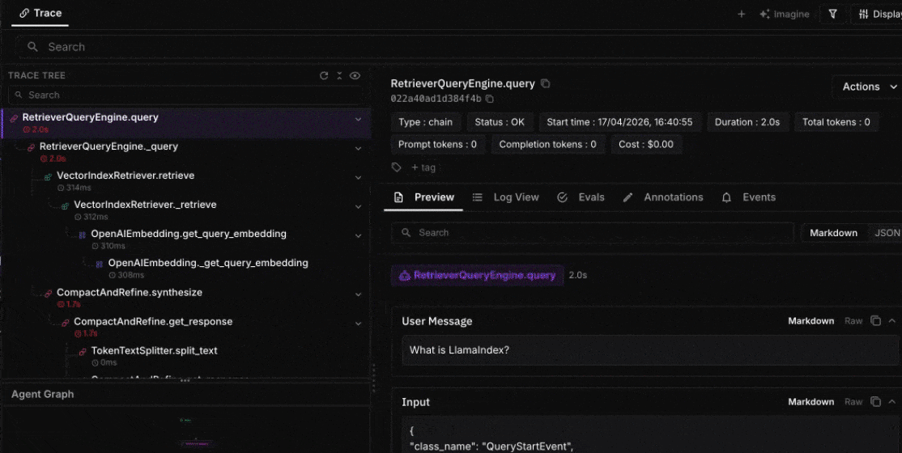
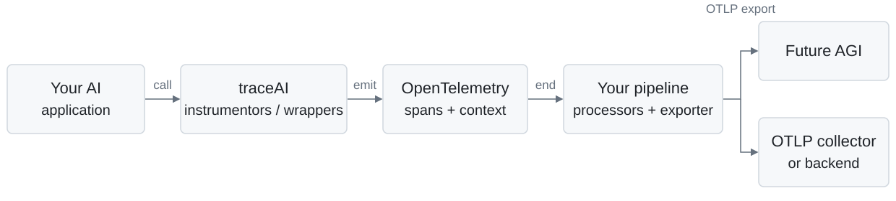

<div align="center">
  <picture>
    <source media="(prefers-color-scheme: dark)" srcset=".github/assets/traceai-wordmark-dark.png">
    
  </picture>

**OpenTelemetry tracing for AI applications.**

Trace LLM calls, agents, tools, and retrieval. Keep your application code and your observability stack.

**78 integration families · 5 languages · OpenTelemetry-native · Apache 2.0**

[Get started](#quickstart) · [Integrations](#integrations) · [Documentation](https://docs.futureagi.com/docs/tracing) · [Contribute](CONTRIBUTING.md)

[](https://pypi.org/project/fi-instrumentation-otel/)
[](https://www.npmjs.com/package/@traceai/fi-core)
[](https://central.sonatype.com/artifact/com.futureagi/traceai-java-core)
[](https://pkg.go.dev/github.com/future-agi/traceAI/go/openai)
[](https://www.nuget.org/packages/fi-instrumentation-otel)
[](https://github.com/future-agi/traceAI/actions/workflows/python-tests.yml)
[](LICENSE)

</div>

<p align="center">
  
</p>
<p align="center"><sub>A real traced SDK guide assistant: five spans, 500 tokens, and server-computed cost. <a href=".github/assets/trace-preview-provenance.json">Capture and reproduction details</a>.</sub></p>

- **Start at the SDK boundary.** Instrument supported clients and frameworks instead of adding logging around each call.
- **Follow the request.** Connect model calls, retrieval, and tool execution with OpenTelemetry spans and context.
- **Choose what leaves your app.** Configure content masking and export through your own OpenTelemetry pipeline.

## Quickstart

Pick your language. These examples send traces to [Future AGI](https://app.futureagi.com); you can also supply your own OpenTelemetry tracer provider and exporter.

| Language | Instrumentation | Install / coordinates |
| :--- | :--- | :--- |
| [Python](#python) | Framework instrumentors · Python 3.10–3.13 for this example | `pip install fi-instrumentation-otel traceai-openai` |
| [TypeScript / JavaScript](#typescript--javascript) | Node.js instrumentors · OpenAI SDK 4 or 5 | `npm install @traceai/fi-core @traceai/openai` |
| [Java](#java) | Client wrappers · Java 17+ | Maven: `com.futureagi:traceai-java-openai:1.0.0` |
| [Go](#go) | Middleware · Go 1.26+ for OpenAI | `go get github.com/future-agi/traceAI/go/openai@latest` |
| [C#](#c) | Manual spans and activities · .NET 10 | `dotnet add package fi-instrumentation-otel` |

Set your credentials in the environment, not in source code. The OpenAI examples use `OPENAI_MODEL`; C# creates a manual span and needs only the Future AGI keys.

```bash
export FI_API_KEY="your-future-agi-api-key"
export FI_SECRET_KEY="your-future-agi-secret-key"
export OPENAI_API_KEY="your-openai-api-key"
export OPENAI_MODEL="gpt-4.1"  # Choose a model available to your account.
```

### Python

```bash
pip install fi-instrumentation-otel traceai-openai
```

Save as `quickstart.py`, then run `python quickstart.py`.

```python
import os
from openai import OpenAI
from fi_instrumentation import register
from fi_instrumentation.fi_types import ProjectType
from traceai_openai import OpenAIInstrumentor

provider = register(project_name="traceai-quickstart", project_type=ProjectType.OBSERVE)
OpenAIInstrumentor().instrument(tracer_provider=provider)
try:
    response = OpenAI().chat.completions.create(
        model=os.environ["OPENAI_MODEL"],
        messages=[{"role": "user", "content": "Say hello in one word."}],
    )
    print(response.choices[0].message.content)
finally:
    provider.shutdown()  # Flush pending spans before the process exits.
```

[Python SDK](python/) · [OpenAI integration guide](https://docs.futureagi.com/docs/integrations/traceai/openai)

### TypeScript / JavaScript

**Install, instrument, and make a traced OpenAI call**

```bash
npm install @traceai/fi-core @traceai/openai @opentelemetry/instrumentation openai@5
npm install --save-dev tsx typescript @types/node
```

Save as `quickstart.ts`, then run `npx tsx quickstart.ts`. The explicit patch below also works when ESM imports load OpenAI before the instrumentation hook.

```typescript
import OpenAI from "openai";
import { register, ProjectType } from "@traceai/fi-core";
import { OpenAIInstrumentation } from "@traceai/openai";
import { registerInstrumentations } from "@opentelemetry/instrumentation";

const provider = register({
  projectName: "traceai-quickstart",
  projectType: ProjectType.OBSERVE,
});
const instrumentation = new OpenAIInstrumentation();
registerInstrumentations({ tracerProvider: provider, instrumentations: [instrumentation] });
instrumentation.manuallyInstrument(OpenAI); // Explicit patch for ESM imports.

async function main() {
  try {
    const response = await new OpenAI().chat.completions.create({
      model: process.env.OPENAI_MODEL!,
      messages: [{ role: "user", content: "Say hello in one word." }],
    });
    console.log(response.choices[0].message.content);
  } finally {
    await provider.shutdown();
  }
}
main().catch((error) => { console.error(error); process.exitCode = 1; });
```

For CommonJS, register the instrumentation **before** `require("openai")`; the module hook then patches it automatically. Use only one patching approach per application.

[TypeScript SDK](typescript/) · [OpenAI integration guide](https://docs.futureagi.com/docs/integrations/traceai/openai)


### Java

**Add the Maven dependencies and wrap your client**

Add these dependencies to your `pom.xml`. The OpenAI client is a provided dependency, so include it explicitly.

```xml
<dependency>
  <groupId>com.futureagi</groupId>
  <artifactId>traceai-java-openai</artifactId>
  <version>1.0.0</version>
</dependency>
<dependency>
  <groupId>com.openai</groupId>
  <artifactId>openai-java</artifactId>
  <version>0.8.0</version>
</dependency>
```

Save this class as `Quickstart.java` in your Maven project's `src/main/java` directory. Compile with `mvn compile` and run it with your Java application's usual launcher. The explicit `TraceConfig.baseUrl` enables Cloud export; if you remove it, set `FI_BASE_URL=https://api.futureagi.com` in the environment instead. Separately, `OPENAI_BASE_URL` is optional and changes only the model API endpoint (OpenAI by default).

```java
import ai.traceai.TraceAI;
import ai.traceai.TraceConfig;
import ai.traceai.openai.TracedOpenAIClient;
import com.openai.client.okhttp.OpenAIOkHttpClient;
import com.openai.models.ChatCompletionCreateParams;
import com.openai.models.ChatCompletionMessageParam;
import com.openai.models.ChatCompletionUserMessageParam;

public class Quickstart {
    public static void main(String[] args) {
        TraceAI.init(TraceConfig.builder()
            .baseUrl("https://api.futureagi.com")
            .apiKey(System.getenv("FI_API_KEY"))
            .secretKey(System.getenv("FI_SECRET_KEY"))
            .projectName("traceai-quickstart")
            .build());
        try {
            var client = new TracedOpenAIClient(OpenAIOkHttpClient.builder()
                .baseUrl(System.getenv().getOrDefault(
                    "OPENAI_BASE_URL", "https://api.openai.com/v1"))
                .apiKey(System.getenv("OPENAI_API_KEY")).build());
            var response = client.createChatCompletion(ChatCompletionCreateParams.builder()
                .model(System.getenv("OPENAI_MODEL"))
                .addMessage(ChatCompletionMessageParam.ofChatCompletionUserMessageParam(
                    ChatCompletionUserMessageParam.builder()
                        .role(ChatCompletionUserMessageParam.Role.USER)
                        .content(ChatCompletionUserMessageParam.Content.ofTextContent(
                            "Say hello in one word."))
                        .build()))
                .build());
            System.out.println(response.choices().get(0).message().content().orElse(""));
        } finally {
            TraceAI.shutdown();
        }
    }
}
```

[Java SDK and JitPack setup](java/) · [OpenAI Java guide](https://docs.futureagi.com/docs/integrations/traceai/java/openai)


### Go

**Add middleware and a standard OTLP exporter**

From a Go module (`go mod init example.com/my-app` for a new project):

```bash
go get github.com/future-agi/traceAI/go/openai@latest
go get go.opentelemetry.io/otel/exporters/otlp/otlptrace/otlptracehttp@v1.47.0
```

Save as `main.go`, run `go mod tidy`, then `go run .`. Future AGI's OTLP/HTTP endpoint needs both auth headers, the project resource attributes, and an uncompressed body.

```go
package main

import (
    "context"
    "fmt"
    "os"

    traceaiopenai "github.com/future-agi/traceAI/go/openai"
    "github.com/openai/openai-go/v3"
    "github.com/openai/openai-go/v3/option"
    "go.opentelemetry.io/otel/attribute"
    "go.opentelemetry.io/otel/exporters/otlp/otlptrace/otlptracehttp"
    "go.opentelemetry.io/otel/sdk/resource"
    sdktrace "go.opentelemetry.io/otel/sdk/trace"
)

func main() {
    ctx := context.Background()
    exporter, err := otlptracehttp.New(ctx,
        otlptracehttp.WithEndpointURL("https://api.futureagi.com/tracer/v1/traces"),
        otlptracehttp.WithHeaders(map[string]string{
            "X-Api-Key": os.Getenv("FI_API_KEY"),
            "X-Secret-Key": os.Getenv("FI_SECRET_KEY"),
        }),
        otlptracehttp.WithCompression(otlptracehttp.NoCompression),
    )
    if err != nil { panic(err) }
    provider := sdktrace.NewTracerProvider(
        sdktrace.WithBatcher(exporter),
        sdktrace.WithResource(resource.NewSchemaless(
            attribute.String("project_name", "traceai-quickstart"),
            attribute.String("project_type", "observe"),
        )),
    )
    defer provider.Shutdown(ctx)
    client := openai.NewClient(option.WithMiddleware(
        traceaiopenai.Middleware(traceaiopenai.WithTracerProvider(provider)),
    ))
    response, err := client.Chat.Completions.New(ctx, openai.ChatCompletionNewParams{
        Model: os.Getenv("OPENAI_MODEL"),
        Messages: []openai.ChatCompletionMessageParamUnion{
            openai.UserMessage("Say hello in one word."),
        },
    })
    if err != nil { panic(err) }
    fmt.Println(response.Choices[0].Message.Content)
}
```

[OpenAI Go reference and examples](go/openai/) · [All Go integrations](go/)


### C#

**Create a manual span in a .NET application**

```bash
dotnet new console -n TraceAIQuickstart
cd TraceAIQuickstart
dotnet add package fi-instrumentation-otel
```

Replace `Program.cs` with this example, then run `dotnet run`. C# provides explicit tracing APIs; it does not auto-patch the OpenAI client.

```csharp
using FIInstrumentation;
using FIInstrumentation.Types;

var tracer = TraceAI.Register(options =>
{
    options.ProjectName = "traceai-quickstart";
    options.ProjectType = ProjectType.Observe;
});
try
{
    var greeting = tracer.Chain("greet", span =>
    {
        span.SetInput("world");
        var result = "Hello, world!";
        span.SetOutput(result);
        return result;
    });
    Console.WriteLine(greeting);
}
finally
{
    TraceAI.Shutdown();
}
```

[C# source and tests](csharp/) · [Tracing guide](https://docs.futureagi.com/docs/tracing)


After a call finishes, open the `traceai-quickstart` project in **Observe** in Future AGI. Flush or shut down the provider before a short-lived process exits.

## Integrations

**78 integration families, with language coverage you can inspect.** Each SDK link opens its package source. A dash means no dedicated framework package in this repository—not a promise of unsupported runtime behavior.

Python and TypeScript provide framework instrumentors; Java provides client wrappers and framework modules; Go provides middleware and framework integrations. **C# provides [manual spans and activities](csharp/src/FIInstrumentation/), not automatic framework instrumentation**, so its framework cells are intentionally empty.

All 78 families are listed below, grouped by what they integrate. Runtime variants share a row: OpenAI includes Realtime; Google GenAI includes Live; AG2 includes its classic SDK. LangGraph ships in the LangChain integration. Shared SDKs are not counted as integrations. Package availability is not a claim of complete upstream feature compatibility; check each package's source and documentation for its scope.

[Model providers](#model-providers) · [Agent frameworks](#agent-frameworks) · [RAG & vector databases](#rag-vector-databases) · [Tools & search](#tools-search) · [Voice & realtime](#voice-realtime) · [Gateways & proxies](#gateways-proxies) · [Coding agents](#coding-agents) · [Java frameworks](#java-frameworks) · [Other](#other)

<a id="model-providers"></a>

### Model providers

Hosted and local model inference, embeddings, and reranking.

| Integration | Python | TypeScript | Java | Go | C# |
| :--- | :---: | :---: | :---: | :---: | :---: |
|  Amazon Bedrock | [SDK](python/frameworks/bedrock/ "traceAI-bedrock") | [SDK](typescript/packages/traceai_bedrock/ "@traceai/bedrock") | [SDK](java/traceai-java-bedrock/ "traceai-java-bedrock") | — | — |
|  Anthropic | [SDK](python/frameworks/anthropic/ "traceAI-anthropic") | [SDK](typescript/packages/traceai_anthropic/ "@traceai/anthropic") | [SDK](java/traceai-java-anthropic/ "traceai-java-anthropic") | [SDK](go/anthropic/ "github.com/future-agi/traceAI/go/anthropic") | — |
|  Azure OpenAI | — | — | [SDK](java/traceai-java-azure-openai/ "traceai-java-azure-openai") | — | — |
|  Cerebras | [SDK](python/frameworks/cerebras/ "traceAI-cerebras") | [SDK](typescript/packages/traceai_cerebras/ "@traceai/cerebras") | — | — | — |
|  Cohere | [SDK](python/frameworks/cohere/ "traceAI-cohere") | [SDK](typescript/packages/traceai_cohere/ "@traceai/cohere") | [SDK](java/traceai-java-cohere/ "traceai-java-cohere") | — | — |
|  DeepSeek | [SDK](python/frameworks/deepseek/ "traceAI-deepseek") | [SDK](typescript/packages/traceai_deepseek/ "@traceai/deepseek") | — | — | — |
|  Fireworks AI | [SDK](python/frameworks/fireworks/ "traceAI-fireworks") | [SDK](typescript/packages/traceai_fireworks/ "@traceai/fireworks") | — | — | — |
|  Google GenAI (Gemini) | [SDK](python/frameworks/google-genai/ "traceAI-google-genai") · [Live](python/frameworks/google-genai-live/ "traceAI-google-genai-live") | [SDK](typescript/packages/traceai_google_genai/ "@traceai/google-genai") | [SDK](java/traceai-java-google-genai/ "traceai-java-google-genai") | [SDK](go/genai/ "github.com/future-agi/traceAI/go/genai") | — |
|  Groq | [SDK](python/frameworks/groq/ "traceAI-groq") | [SDK](typescript/packages/traceai_groq/ "@traceai/groq") | — | — | — |
|  Hugging Face | [SDK](python/frameworks/huggingface/ "traceAI-huggingface") | [SDK](typescript/packages/traceai_huggingface/ "@traceai/huggingface") | — | — | — |
|  IBM watsonx | — | — | [SDK](java/traceai-java-watsonx/ "traceai-java-watsonx") | — | — |
|  MiniMax | [SDK](python/frameworks/minimax/ "traceAI-minimax") | — | — | — | — |
|  Mistral AI | [SDK](python/frameworks/mistralai/ "traceAI-mistralai") | [SDK](typescript/packages/traceai_mistral/ "@traceai/mistral") | — | — | — |
|  Ollama | [SDK](python/frameworks/ollama/ "traceAI-ollama") | [SDK](typescript/packages/traceai_ollama/ "@traceai/ollama") | [SDK](java/traceai-java-ollama/ "traceai-java-ollama") | — | — |
|  OpenAI | [SDK](python/frameworks/openai/ "traceAI-openai") · [Realtime](python/frameworks/openai-realtime/ "traceAI-openai-realtime") | [SDK](typescript/packages/traceai_openai/ "@traceai/openai") | [SDK](java/traceai-java-openai/ "traceai-java-openai") | [SDK](go/openai/ "github.com/future-agi/traceAI/go/openai") | — |
|  Replicate | [SDK](python/frameworks/replicate/ "traceAI-replicate") | — | — | — | — |
|  Together AI | [SDK](python/frameworks/together/ "traceAI-together") | [SDK](typescript/packages/traceai_together/ "@traceai/together") | — | — | — |
|  Vertex AI | [SDK](python/frameworks/vertexai/ "traceAI-vertexai") | [SDK](typescript/packages/traceai_vertexai/ "@traceai/fi-instrumentation-vertexai") | [SDK](java/traceai-java-vertexai/ "traceai-java-vertexai") | — | — |
|  vLLM | [SDK](python/frameworks/vllm/ "traceAI-vllm") | [SDK](typescript/packages/traceai_vllm/ "@traceai/vllm") | — | — | — |
|  Voyage AI | [SDK](python/frameworks/voyage/ "traceAI-voyage") | — | — | — | — |
|  xAI | [SDK](python/frameworks/xai/ "traceAI-xai") | [SDK](typescript/packages/traceai_xai/ "@traceai/xai") | — | — | — |

<a id="agent-frameworks"></a>

### Agent frameworks

Agent orchestration, application frameworks, and agent-to-agent communication.

| Integration | Python | TypeScript | Java | Go | C# |
| :--- | :---: | :---: | :---: | :---: | :---: |
|  A2A | [SDK](python/frameworks/a2a/ "traceAI-a2a") | — | — | [SDK](go/a2a/ "github.com/future-agi/traceAI/go/a2a") | — |
|  AG2 | [SDK](python/frameworks/ag2/ "traceAI-ag2") · [Classic](python/frameworks/ag2-classic/ "traceAI-ag2-classic") | — | — | — | — |
|  AgentScope | [SDK](python/frameworks/agentscope/ "traceAI-agentscope") | — | — | — | — |
|  Agno | [SDK](python/frameworks/agno/ "traceai-agno") | — | — | — | — |
|  AutoGen | [SDK](python/frameworks/autogen/ "traceAI-autogen") | — | — | — | — |
|  BeeAI | [SDK](python/frameworks/beeai/ "traceai-beeai") | [SDK](typescript/packages/traceai_beeai/ "@traceai/beeai") | — | — | — |
|  CrewAI | [SDK](python/frameworks/crewai/ "traceAI-crewai") | — | — | — | — |
|  Eino | — | — | — | [SDK](go/eino/ "github.com/future-agi/traceAI/go/eino") | — |
|  Genkit | — | [SDK](typescript/packages/traceai_genkit/ "@traceai/genkit") | — | — | — |
|  Google ADK | [SDK](python/frameworks/google-adk/ "traceAI-google-adk") | [SDK](typescript/packages/traceai_google_adk/ "@traceai/fi-instrumentation-google-adk") | — | — | — |
|  Hermes Agent | [SDK](python/frameworks/hermes-agent/ "traceAI-hermes-agent") | — | — | — | — |
|  LangChain / LangGraph | [SDK](python/frameworks/langchain/ "traceAI-langchain") | [SDK](typescript/packages/traceai_langchain/ "@traceai/langchain") | — | — | — |
|  Mastra | — | [SDK](typescript/packages/traceai_mastra/ "@traceai/mastra") | — | — | — |
|  MCP-use | [SDK](python/frameworks/mcp-use/ "traceAI-mcp-use") | — | — | — | — |
|  Microsoft Agent Framework | [SDK](python/frameworks/agent-framework/ "traceAI-agent-framework") | — | — | — | — |
|  OpenAI Agents | [SDK](python/frameworks/openai-agents/ "traceAI-openai-agents") | [SDK](typescript/packages/traceai_openai_agents/ "@traceai/openai-agents") | — | — | — |
|  Pydantic AI | [SDK](python/frameworks/pydantic-ai/ "traceai-pydantic-ai") | — | — | — | — |
|  Semantic Kernel | [SDK](python/frameworks/semantic-kernel/ "traceAI-semantic-kernel") | — | [SDK](java/traceai-java-semantic-kernel/ "traceai-java-semantic-kernel") | — | — |
|  Smolagents | [SDK](python/frameworks/smolagents/ "traceAI-smolagents") | — | — | — | — |
|  Strands Agents | [SDK](python/frameworks/strands/ "traceai-strands") | [SDK](typescript/packages/traceai_strands/ "@traceai/strands") | — | — | — |
|  Vercel AI SDK | — | [SDK](typescript/packages/traceai_vercel/ "@traceai/vercel") | — | — | — |
|  VoltAgent | — | [SDK](typescript/packages/traceai_voltagent/ "@traceai/voltagent") | — | — | — |

<a id="rag-vector-databases"></a>

### RAG & vector databases

Retrieval pipelines, vector stores, and search backends.

| Integration | Python | TypeScript | Java | Go | C# |
| :--- | :---: | :---: | :---: | :---: | :---: |
|  Azure AI Search | — | — | [SDK](java/traceai-java-azure-search/ "traceai-java-azure-search") | — | — |
|  Chroma | [SDK](python/frameworks/chromadb/ "traceAI-chromadb") | [SDK](typescript/packages/traceai_chromadb/ "@traceai/chromadb") | [SDK](java/traceai-java-chromadb/ "traceai-java-chromadb") | — | — |
|  Cognee | [SDK](python/frameworks/cognee/ "traceai-cognee") | — | — | — | — |
|  Elasticsearch | — | — | [SDK](java/traceai-java-elasticsearch/ "traceai-java-elasticsearch") | — | — |
|  Google Discovery Engine | [SDK](python/frameworks/discoveryengine/ "traceAI-discoveryengine") | — | — | — | — |
|  Haystack | [SDK](python/frameworks/haystack/ "traceAI-haystack") | — | — | — | — |
|  LanceDB | [SDK](python/frameworks/lancedb/ "traceAI-lancedb") | [SDK](typescript/packages/traceai_lancedb/ "@traceai/lancedb") | — | — | — |
|  LlamaIndex | [SDK](python/frameworks/llama_index/ "traceAI-llamaindex") | [SDK](typescript/packages/traceai_llamaindex/ "@traceai/llamaindex") | — | — | — |
|  Milvus | [SDK](python/frameworks/milvus/ "traceAI-milvus") | [SDK](typescript/packages/traceai_milvus/ "@traceai/milvus") | [SDK](java/traceai-java-milvus/ "traceai-java-milvus") | — | — |
|  MongoDB Atlas Vector Search | [SDK](python/frameworks/mongodb-vector/ "traceAI-mongodb") | [SDK](typescript/packages/traceai_mongodb/ "@traceai/mongodb") | [SDK](java/traceai-java-mongodb/ "traceai-java-mongodb") | — | — |
|  pgvector | [SDK](python/frameworks/pgvector/ "traceAI-pgvector") | [SDK](typescript/packages/traceai_pgvector/ "@traceai/pgvector") | [SDK](java/traceai-java-pgvector/ "traceai-java-pgvector") | — | — |
|  Pinecone | [SDK](python/frameworks/pinecone/ "traceAI-pinecone") | [SDK](typescript/packages/traceai_pinecone/ "@traceai/pinecone") | [SDK](java/traceai-java-pinecone/ "traceai-java-pinecone") | — | — |
|  Qdrant | [SDK](python/frameworks/qdrant/ "traceAI-qdrant") | [SDK](typescript/packages/traceai_qdrant/ "@traceai/qdrant") | [SDK](java/traceai-java-qdrant/ "traceai-java-qdrant") | — | — |
|  Redis Vector Search | [SDK](python/frameworks/redis-vector/ "traceAI-redis") | [SDK](typescript/packages/traceai_redis/ "@traceai/redis") | [SDK](java/traceai-java-redis/ "traceai-java-redis") | — | — |
|  Weaviate | [SDK](python/frameworks/weaviate/ "traceAI-weaviate") | [SDK](typescript/packages/traceai_weaviate/ "@traceai/weaviate") | [SDK](java/traceai-java-weaviate/ "traceai-java-weaviate") | — | — |

<a id="tools-search"></a>

### Tools & search

Tool connectivity, web search, crawling, and extraction.

| Integration | Python | TypeScript | Java | Go | C# |
| :--- | :---: | :---: | :---: | :---: | :---: |
|  Exa | [SDK](python/frameworks/exa/ "traceAI-exa") | — | — | — | — |
|  Firecrawl | [SDK](python/frameworks/firecrawl/ "traceAI-firecrawl") | — | — | — | — |
|  MCP | [SDK](python/frameworks/mcp/ "traceAI-mcp") | [SDK](typescript/packages/traceai_mcp/ "@traceai/mcp") | — | — | — |
|  Parallel | [SDK](python/frameworks/parallel/ "traceAI-parallel") | — | — | — | — |
|  Tavily | [SDK](python/frameworks/tavily/ "traceAI-tavily") | — | — | — | — |

<a id="voice-realtime"></a>

### Voice & realtime

Voice-agent pipelines and conversations. OpenAI Realtime and Google GenAI Live are linked in their provider rows under [Model providers](#model-providers).

| Integration | Python | TypeScript | Java | Go | C# |
| :--- | :---: | :---: | :---: | :---: | :---: |
|  ElevenLabs Agents | [SDK](python/frameworks/elevenlabs-agents/ "traceAI-elevenlabs-agents") | — | — | — | — |
|  LiveKit | [SDK](python/frameworks/livekit/ "traceAI-livekit") | [SDK](typescript/packages/traceai_livekit/ "@traceai/fi-instrumentation-livekit") | — | — | — |
|  Pipecat | [SDK](python/frameworks/pipecat/ "traceAI-pipecat") | [SDK](typescript/packages/traceai_pipecat/ "@traceai/fi-instrumentation-pipecat") | — | — | — |

<a id="gateways-proxies"></a>

### Gateways & proxies

Unified access and routing across model providers.

| Integration | Python | TypeScript | Java | Go | C# |
| :--- | :---: | :---: | :---: | :---: | :---: |
|  LiteLLM | [SDK](python/frameworks/litellm/ "traceAI-litellm") | — | — | — | — |
|  Portkey | [SDK](python/frameworks/portkey/ "traceAI-portkey") | [SDK](typescript/packages/traceai_portkey/ "@traceai/portkey") | — | — | — |

<a id="coding-agents"></a>

### Coding agents

In-process SDK integrations for coding-agent runs, sessions, and tools.

| Integration | Python | TypeScript | Java | Go | C# |
| :--- | :---: | :---: | :---: | :---: | :---: |
|  Claude Agent SDK | [SDK](python/frameworks/claude-agent-sdk/ "traceai-claude-agent-sdk") | [SDK](typescript/packages/traceai_claude_agent_sdk/ "@traceai/claude-agent-sdk") | — | — | — |
|  Codex SDK | — | [SDK](typescript/packages/traceai_codex_sdk/ "@traceai/codex-sdk") | — | — | — |
|  Cursor SDK | — | [SDK](typescript/packages/traceai_cursor_sdk/ "@traceai/cursor-sdk") | — | — | — |
|  Pi Coding Agent | — | [SDK](typescript/packages/traceai_pi_coding_agent/ "@traceai/pi-coding-agent") | — | — | — |

<a id="java-frameworks"></a>

### Java frameworks

Java application-framework integrations and auto-configuration.

| Integration | Python | TypeScript | Java | Go | C# |
| :--- | :---: | :---: | :---: | :---: | :---: |
|  LangChain4j | — | — | [SDK](java/traceai-langchain4j/ "traceai-langchain4j") | — | — |
|  Spring AI | — | — | [SDK](java/traceai-spring-ai/ "traceai-spring-ai") | — | — |
|  Spring Boot | — | — | [SDK](java/traceai-spring-boot-starter/ "traceai-spring-boot-starter") | — | — |

<a id="other"></a>

### Other

LLM programming, structured output, validation, and evaluation.

| Integration | Python | TypeScript | Java | Go | C# |
| :--- | :---: | :---: | :---: | :---: | :---: |
|  DSPy | [SDK](python/frameworks/dspy/ "traceAI-DSPy") | — | — | — | — |
|  Guardrails AI | [SDK](python/frameworks/guardrails/ "traceAI-guardrails") | [SDK](typescript/packages/traceai_guardrails/ "@traceai/guardrails") | — | — | — |
|  Instructor | [SDK](python/frameworks/instructor/ "traceAI-instructor") | [SDK](typescript/packages/traceai_instructor/ "@traceai/instructor") | — | — | — |
|  TypeSafe | [SDK](python/frameworks/typesafe/ "traceAI-typesafe") | — | — | — | — |

**Bring existing telemetry:** [OpenInference](https://docs.futureagi.com/docs/integrations/import/openinference) · [OpenLLMetry](https://docs.futureagi.com/docs/integrations/otel/openllmetry)

**Source indexes:** [Python packages](python/frameworks/) · [TypeScript packages](typescript/packages/) · [Java modules](java/) · [Go modules](go/) · [C# APIs](csharp/src/FIInstrumentation/)

[Counting method and manifest inventory](.github/assets/integration-coverage.json) · Regenerate with `python3 .github/assets/generate-coverage.py` (Python 3.11+).

Brand marks identify integrations, not partnerships or endorsements. A neutral package icon is used where no brand asset is bundled. [Asset sources and licenses](.github/assets/integrations/provenance.json).

## OpenTelemetry, without a new tracing stack

<picture>
  <source media="(prefers-color-scheme: dark)" srcset=".github/assets/architecture-dark.svg">
  
</picture>

- **Use your existing provider.** Python and TypeScript instrumentors accept an OpenTelemetry tracer provider; Go middleware accepts one through `WithTracerProvider`. The examples above configure Future AGI, not a mandatory export destination.
- **Keep standard transport.** SDKs use OpenTelemetry span processing and OTLP exporters. With your own provider and exporter, configure the destination and authentication for your backend; Future AGI keys are only needed for Future AGI.
- **Read the actual attributes.** traceAI uses names such as `gen_ai.request.model`, `gen_ai.usage.input_tokens`, `input.value`, and `output.value`, alongside its own span-kind and context fields. Coverage and attribute names vary by integration. These are not a claim of complete conformance to a particular revision of the evolving OTel GenAI specification.

[Python attribute definitions](python/fi_instrumentation/fi_types.py) · [TypeScript semantic conventions](typescript/packages/fi-semantic-conventions/src/trace/SemanticConventions.ts) · [OpenAI Go capture contract](go/openai/README.md#what-is-captured)

## Privacy controls

Content capture is enabled by default. Decide what may leave your application **before** you initialize instrumentation.

The following environment variables are implemented by the **Python and TypeScript** trace configuration:

| Variable | What it hides |
| :--- | :--- |
| `FI_HIDE_INPUTS=true` | Input values and input messages |
| `FI_HIDE_OUTPUTS=true` | Output values and output messages |
| `FI_HIDE_INPUT_MESSAGES=true` | Input message attributes |
| `FI_HIDE_OUTPUT_MESSAGES=true` | Output message attributes |
| `FI_HIDE_INPUT_TEXT=true` / `FI_HIDE_OUTPUT_TEXT=true` | Text inside input / output messages |
| `FI_HIDE_INPUT_IMAGES=true` | Images in input messages |
| `FI_HIDE_EMBEDDING_VECTORS=true` | Embedding vectors |
| `FI_HIDE_ERROR_DETAILS=true` | Error descriptions, exception messages, and stack traces |

For Python and TypeScript, when `FI_HIDE_ERROR_DETAILS` is unset, any input/output value, message, or text hide flag also turns on error-detail hiding. Explicit `true` or `false` overrides that derived value. Error status and error/exception types remain available.

[Python configuration](python/fi_instrumentation/instrumentation/config.py) · [TypeScript configuration](typescript/packages/fi-core/src/trace/trace-config/constants.ts) · [Go-specific controls](go/openai/README.md#privacy) · [Java configuration](java/traceai-java-core/src/main/java/ai/traceai/TraceConfig.java) · [C# configuration](csharp/src/FIInstrumentation/TraceConfig.cs)

Configuration coverage differs across languages. Masking is not a guarantee that arbitrary user metadata, manually added attributes, or every provider-specific payload is free of sensitive data. Review the attributes your application exports.

## Contribute and connect

Add an integration, improve an example, or bring a reproducible bug. Start with the [contributing guide](CONTRIBUTING.md) or [open an issue](https://github.com/future-agi/traceAI/issues).

traceAI is built by [Future AGI](https://futureagi.com) and [open-source contributors](https://github.com/future-agi/traceAI/graphs/contributors). For the platform that uses these traces for debugging and evaluation, see [future-agi/future-agi](https://github.com/future-agi/future-agi).

**License:** [Apache 2.0](LICENSE).
