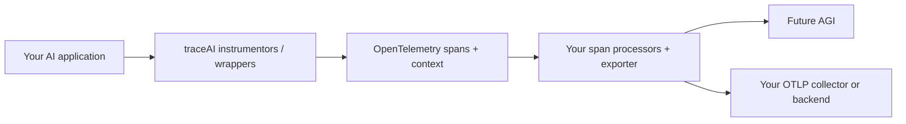

<div align="center">
  <picture>
    <source media="(prefers-color-scheme: dark)" srcset=".github/assets/traceai-wordmark-dark.png">
    
  </picture>

**OpenTelemetry tracing for AI applications.**

Trace LLM calls, agents, tools, and retrieval. Keep your application code and your observability stack.

[Get started](#quickstart) · [Integrations](#integrations) · [Documentation](https://docs.futureagi.com/docs/tracing) · [Contribute](CONTRIBUTING.md)

[](https://pypi.org/project/fi-instrumentation-otel/)
[](https://www.npmjs.com/package/@traceai/fi-core)
[](https://central.sonatype.com/search?q=com.futureagi)
[](go/openai/)
[](https://www.nuget.org/packages/fi-instrumentation-otel)
[](https://github.com/future-agi/traceAI/actions/workflows/python-tests.yml)
[](LICENSE)

</div>

<p align="center">
  
</p>
<p align="center"><sub>A LlamaIndex request in Future AGI. Trace tree, retrieval, and captured context in one view.</sub></p>

- **Start at the SDK boundary.** Instrument supported clients and frameworks instead of adding logging around each call.
- **Follow the request.** Connect model calls, retrieval, and tool execution with OpenTelemetry spans and context.
- **Choose what leaves your app.** Configure content masking and export through your own OpenTelemetry pipeline.

## Quickstart

Pick your language. These examples send traces to [Future AGI](https://app.futureagi.com); you can also supply your own OpenTelemetry tracer provider and exporter.

| Language | Instrumentation | Install / coordinates |
| :--- | :--- | :--- |
| [Python](#python) | Framework instrumentors · Python 3.10–3.13 for this example | `pip install fi-instrumentation-otel traceai-openai` |
| [TypeScript / JavaScript](#typescript--javascript) | Node.js instrumentors · OpenAI SDK 4 or 5 | `npm install @traceai/fi-core @traceai/openai` |
| [Java](#java) | Client wrappers · Java 17+ | Maven: `com.futureagi:traceai-java-openai:1.0.0` |
| [Go](#go) | Middleware · Go 1.26+ for OpenAI | `go get github.com/future-agi/traceAI/go/openai@latest` |
| [C#](#c) | Manual spans and activities · .NET 10 | `dotnet add package fi-instrumentation-otel` |

Set your credentials in the environment, not in source code. The OpenAI examples use `OPENAI_MODEL`; C# creates a manual span and needs only the Future AGI keys.

```bash
export FI_API_KEY="your-future-agi-api-key"
export FI_SECRET_KEY="your-future-agi-secret-key"
export OPENAI_API_KEY="your-openai-api-key"
export OPENAI_MODEL="gpt-4.1"  # Choose a model available to your account.
```

### Python

```bash
pip install fi-instrumentation-otel traceai-openai
```

Save as `quickstart.py`, then run `python quickstart.py`.

```python
import os
from openai import OpenAI
from fi_instrumentation import register
from fi_instrumentation.fi_types import ProjectType
from traceai_openai import OpenAIInstrumentor

provider = register(project_name="traceai-quickstart", project_type=ProjectType.OBSERVE)
OpenAIInstrumentor().instrument(tracer_provider=provider)
try:
    response = OpenAI().chat.completions.create(
        model=os.environ["OPENAI_MODEL"],
        messages=[{"role": "user", "content": "Say hello in one word."}],
    )
    print(response.choices[0].message.content)
finally:
    provider.shutdown()  # Flush pending spans before the process exits.
```

[Python SDK](python/) · [OpenAI integration guide](https://docs.futureagi.com/docs/integrations/traceai/openai)

### TypeScript / JavaScript

<details>
<summary><strong>Install, instrument, and make a traced OpenAI call</strong></summary>

```bash
npm install @traceai/fi-core @traceai/openai @opentelemetry/instrumentation openai@5
npm install --save-dev tsx typescript @types/node
```

Save as `quickstart.ts`, then run `npx tsx quickstart.ts`. The explicit patch below also works when ESM imports load OpenAI before the instrumentation hook.

```typescript
import OpenAI from "openai";
import { register, ProjectType } from "@traceai/fi-core";
import { OpenAIInstrumentation } from "@traceai/openai";
import { registerInstrumentations } from "@opentelemetry/instrumentation";

const provider = register({
  projectName: "traceai-quickstart",
  projectType: ProjectType.OBSERVE,
});
const instrumentation = new OpenAIInstrumentation();
registerInstrumentations({ tracerProvider: provider, instrumentations: [instrumentation] });
instrumentation.manuallyInstrument(OpenAI); // Explicit patch for ESM imports.

async function main() {
  try {
    const response = await new OpenAI().chat.completions.create({
      model: process.env.OPENAI_MODEL!,
      messages: [{ role: "user", content: "Say hello in one word." }],
    });
    console.log(response.choices[0].message.content);
  } finally {
    await provider.shutdown();
  }
}
main().catch((error) => { console.error(error); process.exitCode = 1; });
```

For CommonJS, register the instrumentation **before** `require("openai")`; the module hook then patches it automatically. Use only one patching approach per application.

[TypeScript SDK](typescript/) · [OpenAI integration guide](https://docs.futureagi.com/docs/integrations/traceai/openai)

</details>

### Java

<details>
<summary><strong>Add the Maven dependencies and wrap your client</strong></summary>

Add these dependencies to your `pom.xml`. The OpenAI client is a provided dependency, so include it explicitly.

```xml
<dependency>
  <groupId>com.futureagi</groupId>
  <artifactId>traceai-java-openai</artifactId>
  <version>1.0.0</version>
</dependency>
<dependency>
  <groupId>com.openai</groupId>
  <artifactId>openai-java</artifactId>
  <version>0.8.0</version>
</dependency>
```

Save this class as `Quickstart.java` in your Maven project's `src/main/java` directory. Compile with `mvn compile` and run it with your Java application's usual launcher.

```java
import ai.traceai.TraceAI;
import ai.traceai.TraceConfig;
import ai.traceai.openai.TracedOpenAIClient;
import com.openai.client.okhttp.OpenAIOkHttpClient;
import com.openai.models.ChatCompletionCreateParams;
import com.openai.models.ChatCompletionMessageParam;
import com.openai.models.ChatCompletionUserMessageParam;

public class Quickstart {
    public static void main(String[] args) {
        TraceAI.init(TraceConfig.builder()
            .apiKey(System.getenv("FI_API_KEY"))
            .secretKey(System.getenv("FI_SECRET_KEY"))
            .projectName("traceai-quickstart")
            .build());
        try {
            var client = new TracedOpenAIClient(OpenAIOkHttpClient.builder()
                .apiKey(System.getenv("OPENAI_API_KEY")).build());
            var response = client.createChatCompletion(ChatCompletionCreateParams.builder()
                .model(System.getenv("OPENAI_MODEL"))
                .addMessage(ChatCompletionMessageParam.ofChatCompletionUserMessageParam(
                    ChatCompletionUserMessageParam.builder()
                        .role(ChatCompletionUserMessageParam.Role.USER)
                        .content(ChatCompletionUserMessageParam.Content.ofTextContent(
                            "Say hello in one word."))
                        .build()))
                .build());
            System.out.println(response.choices().get(0).message().content().orElse(""));
        } finally {
            TraceAI.shutdown();
        }
    }
}
```

[Java SDK and JitPack setup](java/) · [OpenAI Java guide](https://docs.futureagi.com/docs/integrations/traceai/java/openai)

</details>

### Go

<details>
<summary><strong>Add middleware and a standard OTLP exporter</strong></summary>

From a Go module (`go mod init example.com/my-app` for a new project):

```bash
go get github.com/future-agi/traceAI/go/openai@latest
go get go.opentelemetry.io/otel/exporters/otlp/otlptrace/otlptracehttp@v1.47.0
```

Save as `main.go`, run `go mod tidy`, then `go run .`. Future AGI's OTLP/HTTP endpoint needs both auth headers, the project resource attributes, and an uncompressed body.

```go
package main

import (
    "context"
    "fmt"
    "os"

    traceaiopenai "github.com/future-agi/traceAI/go/openai"
    "github.com/openai/openai-go/v3"
    "github.com/openai/openai-go/v3/option"
    "go.opentelemetry.io/otel/attribute"
    "go.opentelemetry.io/otel/exporters/otlp/otlptrace/otlptracehttp"
    "go.opentelemetry.io/otel/sdk/resource"
    sdktrace "go.opentelemetry.io/otel/sdk/trace"
)

func main() {
    ctx := context.Background()
    exporter, err := otlptracehttp.New(ctx,
        otlptracehttp.WithEndpointURL("https://api.futureagi.com/tracer/v1/traces"),
        otlptracehttp.WithHeaders(map[string]string{
            "X-Api-Key": os.Getenv("FI_API_KEY"),
            "X-Secret-Key": os.Getenv("FI_SECRET_KEY"),
        }),
        otlptracehttp.WithCompression(otlptracehttp.NoCompression),
    )
    if err != nil { panic(err) }
    provider := sdktrace.NewTracerProvider(
        sdktrace.WithBatcher(exporter),
        sdktrace.WithResource(resource.NewSchemaless(
            attribute.String("project_name", "traceai-quickstart"),
            attribute.String("project_type", "observe"),
        )),
    )
    defer provider.Shutdown(ctx)
    client := openai.NewClient(option.WithMiddleware(
        traceaiopenai.Middleware(traceaiopenai.WithTracerProvider(provider)),
    ))
    response, err := client.Chat.Completions.New(ctx, openai.ChatCompletionNewParams{
        Model: os.Getenv("OPENAI_MODEL"),
        Messages: []openai.ChatCompletionMessageParamUnion{
            openai.UserMessage("Say hello in one word."),
        },
    })
    if err != nil { panic(err) }
    fmt.Println(response.Choices[0].Message.Content)
}
```

[OpenAI Go reference and examples](go/openai/) · [All Go integrations](go/)

</details>

### C#

<details>
<summary><strong>Create a manual span in a .NET application</strong></summary>

```bash
dotnet new console -n TraceAIQuickstart
cd TraceAIQuickstart
dotnet add package fi-instrumentation-otel
```

Replace `Program.cs` with this example, then run `dotnet run`. C# provides explicit tracing APIs; it does not auto-patch the OpenAI client.

```csharp
using FIInstrumentation;
using FIInstrumentation.Types;

var tracer = TraceAI.Register(options =>
{
    options.ProjectName = "traceai-quickstart";
    options.ProjectType = ProjectType.Observe;
});
try
{
    var greeting = tracer.Chain("greet", span =>
    {
        span.SetInput("world");
        var result = "Hello, world!";
        span.SetOutput(result);
        return result;
    });
    Console.WriteLine(greeting);
}
finally
{
    TraceAI.Shutdown();
}
```

[C# source and tests](csharp/) · [Tracing guide](https://docs.futureagi.com/docs/tracing)

</details>

After a call finishes, open the `traceai-quickstart` project in **Observe** in Future AGI. Flush or shut down the provider before a short-lived process exits.

## Integrations

Choose a guide for setup and language coverage. Framework support differs by SDK; the source indexes below are the complete package inventory.

### Model providers

[ OpenAI](https://docs.futureagi.com/docs/integrations/traceai/openai) · [ Anthropic](https://docs.futureagi.com/docs/integrations/traceai/anthropic) · [ Gemini](https://docs.futureagi.com/docs/integrations/traceai/google_genai) · [ Bedrock](https://docs.futureagi.com/docs/integrations/traceai/bedrock)

### Agents and RAG

[ LangChain](https://docs.futureagi.com/docs/integrations/traceai/langchain) · [ LangGraph](https://docs.futureagi.com/docs/integrations/traceai/langgraph) · [ LlamaIndex](https://docs.futureagi.com/docs/integrations/traceai/llamaindex) · [ CrewAI](https://docs.futureagi.com/docs/integrations/traceai/crewai)

### Tools and structured output

[ MCP](https://docs.futureagi.com/docs/integrations/traceai/mcp) · [Instructor](https://docs.futureagi.com/docs/integrations/traceai/instructor) · [ Guardrails AI](https://docs.futureagi.com/docs/integrations/traceai/guardrails) · [ DSPy](https://docs.futureagi.com/docs/integrations/traceai/dspy)

### Voice and real-time

[ LiveKit](https://docs.futureagi.com/docs/integrations/traceai/livekit) · [ Pipecat](https://docs.futureagi.com/docs/integrations/traceai/pipecat)

### Java frameworks and vector stores

[ Spring Boot](https://docs.futureagi.com/docs/integrations/traceai/spring-boot) · [Java frameworks](https://docs.futureagi.com/docs/integrations/traceai/java/frameworks) · [ Pinecone](https://docs.futureagi.com/docs/integrations/traceai/java/pinecone) · [Vector databases](https://docs.futureagi.com/docs/integrations/traceai/java/vector-databases)

<details>
<summary><strong>More providers, agent frameworks, and interoperability guides</strong></summary>

**More models**

[ Groq](https://docs.futureagi.com/docs/integrations/traceai/groq) · [ Mistral](https://docs.futureagi.com/docs/integrations/traceai/mistralai) · [ Cohere (Java)](https://docs.futureagi.com/docs/integrations/traceai/java/cohere) · [ Together AI](https://docs.futureagi.com/docs/integrations/traceai/togetherai) · [ Vertex AI](https://docs.futureagi.com/docs/integrations/traceai/vertexai) · [ Ollama](https://docs.futureagi.com/docs/integrations/traceai/ollama) · [ LiteLLM](https://docs.futureagi.com/docs/integrations/traceai/litellm)

**More frameworks**

[ Google ADK](https://docs.futureagi.com/docs/integrations/traceai/google_adk) · [ OpenAI Agents](https://docs.futureagi.com/docs/integrations/traceai/openai_agents) · [ AutoGen](https://docs.futureagi.com/docs/integrations/traceai/autogen) · [SmolAgents](https://docs.futureagi.com/docs/integrations/traceai/smol_agents) · [ Mastra](https://docs.futureagi.com/docs/integrations/traceai/mastra) · [ Vercel AI SDK](https://docs.futureagi.com/docs/integrations/traceai/vercel) · [ Haystack](https://docs.futureagi.com/docs/integrations/traceai/haystack)

**Bring existing telemetry**

[OpenInference](https://docs.futureagi.com/docs/integrations/import/openinference) · [OpenLLMetry](https://docs.futureagi.com/docs/integrations/otel/openllmetry)

</details>

**Source indexes:** [Python packages](python/frameworks/) · [TypeScript packages](typescript/packages/) · [Java modules](java/) · [Go modules](go/) · [C# APIs](csharp/src/FIInstrumentation/)

Brand marks identify integrations, not partnerships or endorsements. [Asset sources and licenses](.github/assets/integrations/provenance.json).

## OpenTelemetry, without a new tracing stack



- **Use your existing provider.** Python and TypeScript instrumentors accept an OpenTelemetry tracer provider; Go middleware accepts one through `WithTracerProvider`. The examples above configure Future AGI, not a mandatory export destination.
- **Keep standard transport.** SDKs use OpenTelemetry span processing and OTLP exporters. With your own provider and exporter, configure the destination and authentication for your backend; Future AGI keys are only needed for Future AGI.
- **Read the actual attributes.** traceAI uses names such as `gen_ai.request.model`, `gen_ai.usage.input_tokens`, `input.value`, and `output.value`, alongside its own span-kind and context fields. Coverage and attribute names vary by integration. These are not a claim of complete conformance to a particular revision of the evolving OTel GenAI specification.

[Python attribute definitions](python/fi_instrumentation/fi_types.py) · [TypeScript semantic conventions](typescript/packages/fi-semantic-conventions/src/trace/SemanticConventions.ts) · [OpenAI Go capture contract](go/openai/README.md#what-is-captured)

## Privacy controls

Content capture is enabled by default. Decide what may leave your application **before** you initialize instrumentation.

The following environment variables are implemented by the **Python and TypeScript** trace configuration:

| Variable | What it hides |
| :--- | :--- |
| `FI_HIDE_INPUTS=true` | Input values and input messages |
| `FI_HIDE_OUTPUTS=true` | Output values and output messages |
| `FI_HIDE_INPUT_MESSAGES=true` | Input message attributes |
| `FI_HIDE_OUTPUT_MESSAGES=true` | Output message attributes |
| `FI_HIDE_INPUT_TEXT=true` / `FI_HIDE_OUTPUT_TEXT=true` | Text inside input / output messages |
| `FI_HIDE_INPUT_IMAGES=true` | Images in input messages |
| `FI_HIDE_EMBEDDING_VECTORS=true` | Embedding vectors |
| `FI_HIDE_ERROR_DETAILS=true` | Error descriptions, exception messages, and stack traces |

For Python and TypeScript, when `FI_HIDE_ERROR_DETAILS` is unset, any input/output value, message, or text hide flag also turns on error-detail hiding. Explicit `true` or `false` overrides that derived value. Error status and error/exception types remain available.

[Python configuration](python/fi_instrumentation/instrumentation/config.py) · [TypeScript configuration](typescript/packages/fi-core/src/trace/trace-config/constants.ts) · [Go-specific controls](go/openai/README.md#privacy) · [Java configuration](java/traceai-java-core/src/main/java/ai/traceai/TraceConfig.java) · [C# configuration](csharp/src/FIInstrumentation/TraceConfig.cs)

Configuration coverage differs across languages. Masking is not a guarantee that arbitrary user metadata, manually added attributes, or every provider-specific payload is free of sensitive data. Review the attributes your application exports.

## Contribute and connect

Add an integration, improve an example, or bring a reproducible bug. Start with the [contributing guide](CONTRIBUTING.md) or [open an issue](https://github.com/future-agi/traceAI/issues).

traceAI is built by [Future AGI](https://futureagi.com) and [open-source contributors](https://github.com/future-agi/traceAI/graphs/contributors). For the platform that uses these traces for debugging and evaluation, see [future-agi/future-agi](https://github.com/future-agi/future-agi).

**License:** [Apache 2.0](LICENSE).
