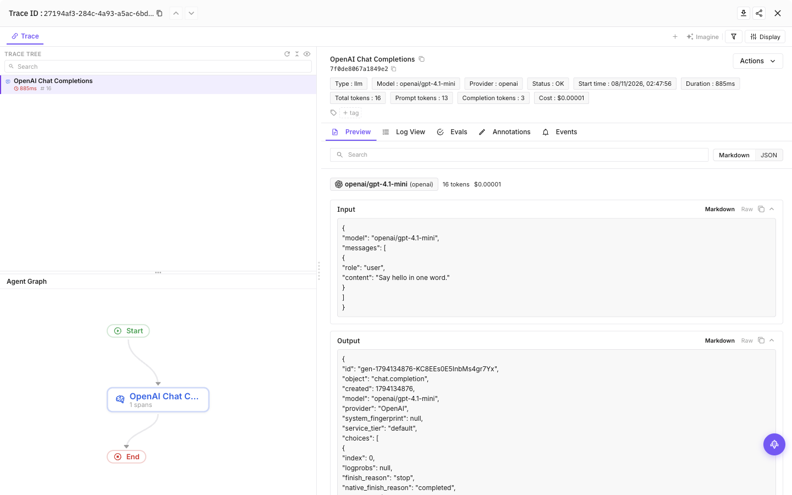

# @traceai/auto

**Trace your Node.js AI calls without changing your application code.** Preload once to capture supported model requests, responses, token usage and timing as OpenTelemetry spans.

[Quick start](#quick-start) · [Coverage](#supported-libraries-and-protocols) · [Privacy](#privacy-defaults) · [Frameworks](#frameworks-and-deployment) · [Troubleshooting](#troubleshooting)

## Quick start

You need **Node.js 20.6+**, an existing Node application, and a [Future AGI](https://app.futureagi.com) API key / secret key pair. Keep your model provider's credentials configured as usual; traceAI does not supply a model key.

Install in your application's directory:

```sh
npm install @traceai/auto
```

Set both FI keys through your deployment's secret manager or shell environment, then start the app with one preload:

```sh
FI_API_KEY="your-api-key" FI_SECRET_KEY="your-secret-key" \
FI_PROJECT_NAME="my-ai-app" \
node --import @traceai/auto/register app.mjs
```

Replace `app.mjs` with your entry file. **Prompts and responses are captured by default.** To hide them, set `FI_HIDE_INPUTS=true FI_HIDE_OUTPUTS=true FI_HIDE_ERROR_DETAILS=true` before startup. See [privacy defaults](#privacy-defaults) before deploying with sensitive data.

Make an AI request, consume the response, then open **Observe → my-ai-app** in Future AGI. For supported calls, the trace includes the provider/model, input and output, duration, and any usage the provider returned. Streaming timing is available when the transport exposes it; missing usage is not invented.

### Keep your existing start command

With the FI variables above already set, use `NODE_OPTIONS` for an npm script or process launcher:

```sh
NODE_OPTIONS="--import @traceai/auto/register" npm start
```

Preserve any other Node flags your deployment already needs. For CommonJS, either use the same `--import` preload or:

```sh
node --require @traceai/auto/register app.cjs
```

Run from the application's directory so target libraries and optional instrumentors can be resolved. Do not add a second preload or manually patch the same client.

### Try it with OpenAI

If you do not have an app yet, install the OpenAI SDK (versions 4 to 7 are supported):

```sh
npm install openai
```

Set `OPENAI_API_KEY` and `OPENAI_MODEL` for a model your account can use. Save this ordinary application code as `app.mjs`, then use the quick-start run command. There are **no tracing imports** in the application:

```js
import OpenAI from "openai";

const response = await new OpenAI().chat.completions.create({
  model: process.env.OPENAI_MODEL,
  messages: [{ role: "user", content: "Say hello in one word." }],
});
console.log(response.choices[0].message.content);
```

The preload flushes completed spans when Node exits naturally. If your app explicitly terminates or runs inside a serverless invocation, use the [lifecycle guidance](https://github.com/future-agi/traceAI/blob/dev/typescript/packages/traceai_auto/docs/FRAMEWORKS.md#aws-lambda-and-short-lived-processes).

## What you get

The **Try it with OpenAI** example, as it appears in Future AGI (a real run with OpenAI SDK 7 and `openai/gpt-4.1-mini` through OpenRouter):



- **Model calls without per-call wrappers.** OpenAI instrumentation is included. Recognized AI requests through the process's global `fetch` are also captured, including compatible gateways.
- **More context from installed integrations.** Dedicated packages can add framework, agent, tool, retrieval and database spans. They retain their own method/version limits; auto-registration does not expand their coverage.
- **One trace, not two copies of each call.** Wire capture yields to covered model spans and respects OpenTelemetry suppression. Existing providers keep their sampler, context and application processors.
- **Standard OpenTelemetry.** Send to Future AGI by default, or use an [application-owned provider/exporter](https://github.com/future-agi/traceAI/blob/dev/typescript/packages/traceai_auto/docs/CONFIGURATION.md#bring-your-own-opentelemetry-destination) without FI credentials.

This is AI instrumentation, not a general-purpose APM agent. Outgoing non-AI HTTP calls, arbitrary application functions and every possible AI transport are not automatically traced.

## Supported libraries and protocols

**Included:** OpenAI library hooks and the global-fetch wire observer. **Optional:** other dedicated instrumentors must be installed alongside their target library. The app always owns installation of its AI SDKs.

To see what your app needs, without installing anything:

```sh
npx --no-install traceai-auto bootstrap
```

Bootstrap lists detected libraries, their status, and suggested install commands. It can also install missing instrumentors with an explicit `--install` flag; see the [CLI reference](https://github.com/future-agi/traceAI/blob/dev/typescript/packages/traceai_auto/docs/CONFIGURATION.md#cli).

### Library coverage

The table below is generated from [`src/integrations.json`](https://github.com/future-agi/traceAI/blob/dev/typescript/packages/traceai_auto/src/integrations.json), the runtime registry. **Import hook** means the package registers hooks for supported target versions. **Enable entry** means automatic setup depends on the installed integration exposing its enable API. **Manual** means framework-level tracing still requires that package's explicit API; eligible underlying global-fetch calls can still be captured.

<details>
<summary>All registered libraries and framework adapters</summary>

<!-- BEGIN GENERATED INTEGRATIONS -->
| Configuration name | Target library | Instrumentation package | Setup |
| --- | --- | --- | --- |
| `anthropic` | `@anthropic-ai/sdk` | `@traceai/anthropic` | Import hook |
| `bedrock` | `@aws-sdk/client-bedrock-runtime` | `@traceai/bedrock` | Import hook |
| `beeai` | `beeai-framework` | `@traceai/beeai` | Import hook |
| `cerebras` | `@cerebras/cerebras_cloud_sdk` | `@traceai/cerebras` | Import hook |
| `chromadb` | `chromadb` | `@traceai/chromadb` | Import hook |
| `claude-agent-sdk` | `@anthropic-ai/claude-agent-sdk` | `@traceai/claude-agent-sdk` | Manual |
| `codex-sdk` | `@openai/codex-sdk` | `@traceai/codex-sdk` | Manual |
| `cohere` | `cohere-ai` | `@traceai/cohere` | Import hook |
| `cursor-sdk` | `@cursor/sdk` | `@traceai/cursor-sdk` | Import hook |
| `deepseek` | `openai` | `@traceai/deepseek` | Import hook |
| `elevenlabs` | `@elevenlabs/elevenlabs-js` | `@traceai/elevenlabs` | Manual |
| `fireworks` | `openai` | `@traceai/fireworks` | Import hook |
| `genkit` | `genkit` | `@traceai/genkit` | Enable entry |
| `google-adk` | `@google/adk` | `@traceai/fi-instrumentation-google-adk` | Import hook |
| `google-genai` | `@google/generative-ai` | `@traceai/google-genai` | Import hook |
| `google-genai-sdk` | `@google/genai` | `@traceai/google-genai-sdk` | Manual |
| `groq` | `groq-sdk` | `@traceai/groq` | Import hook |
| `guardrails` | `@guardrails-ai/core` | `@traceai/guardrails` | Import hook |
| `huggingface` | `@huggingface/inference` | `@traceai/huggingface` | Import hook |
| `huggingface-transformers` | `@huggingface/transformers` | `@traceai/huggingface-transformers` | Manual |
| `instructor` | `@instructor-ai/instructor` | `@traceai/instructor` | Import hook |
| `lancedb` | `@lancedb/lancedb` | `@traceai/lancedb` | Import hook |
| `langchain` | `@langchain/core` | `@traceai/langchain` | Import hook |
| `livekit` | `livekit-client`, `@livekit/rtc-node` | `@traceai/fi-instrumentation-livekit` | Import hook |
| `llamaindex` | `llamaindex`, `@llamaindex/openai` | `@traceai/llamaindex` | Import hook |
| `mastra` | `@mastra/core`, `@mastra/observability`, `@mastra/otel-exporter` | `@traceai/mastra` | Manual |
| `mcp` | `@modelcontextprotocol/sdk` | `@traceai/mcp` | Import hook |
| `milvus` | `@zilliz/milvus2-sdk-node` | `@traceai/milvus` | Import hook |
| `mistral` | `@mistralai/mistralai` | `@traceai/mistral` | Import hook |
| `mongodb` | `mongodb` | `@traceai/mongodb` | Import hook |
| `ollama` | `ollama` | `@traceai/ollama` | Import hook |
| `openai` | `openai` | `@traceai/openai` (included) | Import hook |
| `openai-agents` | `@openai/agents` | `@traceai/openai-agents` | Import hook |
| `pgvector` | `pg`, `pgvector` | `@traceai/pgvector` | Import hook |
| `pi-coding-agent` | `@mariozechner/pi-coding-agent` | `@traceai/pi-coding-agent` | Manual |
| `pinecone` | `@pinecone-database/pinecone` | `@traceai/pinecone` | Import hook |
| `pipecat` | `@pipecat-ai/client-js` | `@traceai/fi-instrumentation-pipecat` | Import hook |
| `portkey` | `portkey-ai` | `@traceai/portkey` | Import hook |
| `qdrant` | `@qdrant/js-client-rest` | `@traceai/qdrant` | Import hook |
| `redis` | `redis` | `@traceai/redis` | Import hook |
| `strands` | `@strands-agents/sdk` | `@traceai/strands` | Import hook |
| `together` | `together-ai` | `@traceai/together` | Import hook |
| `vercel` | `ai` | `@traceai/vercel` | Enable entry |
| `vertexai` | `@google-cloud/vertexai` | `@traceai/fi-instrumentation-vertexai` | Import hook |
| `vllm` | `openai` | `@traceai/vllm` | Import hook |
| `voltagent` | `@voltagent/core` | `@traceai/voltagent` | Manual |
| `weaviate` | `weaviate-client` | `@traceai/weaviate` | Import hook |
| `xai` | `openai` | `@traceai/xai` | Import hook |
<!-- END GENERATED INTEGRATIONS -->

</details>

Dedicated instrumentors other than OpenAI are not installed implicitly. The bundled server-build adapters are inactive until you add their plugin to your build configuration. Genkit and Vercel versions without an enable entry report `manual`. Mastra is manual-only in this release. See each integration's README for supported methods and versions, and use doctor to inspect the version actually installed in your app.

### HTTP protocol coverage

The [wire catalog](https://github.com/future-agi/traceAI/blob/dev/typescript/packages/traceai_auto/src/wire/wire-protocols.json) recognizes OpenAI-compatible chat, Responses, embeddings and media endpoints; Anthropic messages; Gemini/Vertex content and embeddings; Cohere chat/embed/rerank; Bedrock converse/invoke; Ollama; and selected Deepgram, ElevenLabs, AssemblyAI and Cartesia endpoints.

Recognition needs a matching endpoint and request shape, not just an AI-looking URL. Unknown proxy hosts can use compatible protocol fallbacks; provider-restricted endpoints still require a recognized host. Audio bytes are counted, not exported. Bedrock binary event streams are metadata-only. See [capture behavior and transport limits](https://github.com/future-agi/traceAI/blob/dev/typescript/packages/traceai_auto/docs/ARCHITECTURE.md).

## Privacy defaults

| Surface | Default behavior | Your control |
| --- | --- | --- |
| Prompts, model outputs, tool content and transcripts | Captured where supported | `FI_HIDE_INPUTS=true`, `FI_HIDE_OUTPUTS=true`; granular message/text flags are available |
| Error details | Visible unless an input/output value, message, text or invocation-parameter hide flag implies hiding | `FI_HIDE_ERROR_DETAILS=true`; explicit `false` overrides the derived value, not secret/media masking |
| Known credentials and signed URL values | Scrubbed in traceAI's export view | Additional exact secrets can be registered with `registerSecret()`; never rely on this to detect arbitrary free-text secrets |
| PII pattern redaction | **Off** | `FI_PII_REDACTION=true`; pattern matching is not comprehensive PII detection |
| Base64 media and raw audio | Recognized payloads omitted; no audio bytes exported | Image cap defaults to `0`; increasing it does not enable base64 image export |
| Embeddings | Catalog wire formats record dimensions, not vectors | `FI_HIDE_EMBEDDING_VECTORS=true` also hides vectors on library/forwarded and generic-JSON routes |
| Extra instrumentors / server bundler plugins | Extra instrumentors are not installed; build plugins are inactive until configured | Install the integration or explicitly add a server bundler plugin |

The agent sanitizes a detached copy for its own exporter. **Other exporters retain their own privacy policies.** Explicit application-owned processors are not silently rewritten. Host SDK limits may force the FI view to withhold content as `<unknown: host-truncated>` rather than export a partial value. Unknown, transformed or unobserved secrets cannot always be recognized; use the hide flags for sensitive content.

[All privacy flags and defaults](https://github.com/future-agi/traceAI/blob/dev/typescript/packages/traceai_auto/docs/CONFIGURATION.md#privacy-options) · [Detailed privacy boundaries](https://github.com/future-agi/traceAI/blob/dev/typescript/packages/traceai_auto/docs/ARCHITECTURE.md#privacy)

## Configuration

The most-used settings are below. Set them **before** loading the agent; later `init()` calls do not reconfigure it.

| Environment variable | Default | Purpose |
| --- | --- | --- |
| `FI_API_KEY` + `FI_SECRET_KEY` | Unset | Complete pair for the default Future AGI destination |
| `FI_PROJECT_NAME` | See full reference | Project in Observe; set explicitly for stable routing |
| `FI_BASE_URL` | `https://api.futureagi.com` | Collector base URL or full traces endpoint |
| `FI_INSTRUMENTATIONS` | All eligible integrations | Comma-separated allowlist, e.g. `openai,wire` |
| `FI_DISABLED_INSTRUMENTATIONS` | Empty | Denylist; takes precedence over the allowlist |
| `FI_WIRE_CAPTURE` | `true` | Enable global-fetch capture and transport credential observation |
| `FI_SAMPLE_RATE` | `1` | Root sampling ratio on agent-owned providers; existing providers keep their sampler |
| `FI_AUTO_DEBUG` | `false` | Print the masked startup report |
| `OTEL_SDK_DISABLED` | `false` | Disable auto-instrumentation |

[Full configuration reference](https://github.com/future-agi/traceAI/blob/dev/typescript/packages/traceai_auto/docs/CONFIGURATION.md) covers every `init()` option, environment setting, config/profile precedence, privacy flag and CLI command.

## Frameworks and deployment

| Environment | Start here |
| --- | --- |
| Node ESM or CommonJS | Use `--import` before app imports; CommonJS also supports `--require` |
| Next.js Node runtime | Use guarded `instrumentation.ts` and keep the package external; do not import it into an edge path |
| esbuild, Vite SSR, Rollup or webpack | Opt into the Node-server adapter and deploy the complete agent payload; keep AI SDKs external for library hooks |
| AWS Lambda | Initialize once outside the handler and flush at each invocation boundary, not just process exit |
| Edge / browser | The Node preload is not supported. The `/edge` subpath is a low-level fetch observer, not a configured tracing SDK |
| Existing OpenTelemetry setup | Keep one global provider; configure a single export route for each destination |

[Framework recipes and packaging requirements](https://github.com/future-agi/traceAI/blob/dev/typescript/packages/traceai_auto/docs/FRAMEWORKS.md)

## Troubleshooting

Run diagnostics from the app directory with the same FI environment as the app:

```sh
npx --no-install traceai-auto doctor
```

Doctor sends one test span when instrumentation is enabled. Check the JSON `collector` field: `accepted`, `failed` or `not_tested (...)`. **The CLI exit code alone is not a collector-health check.** Doctor is a separate process, so its `pending` library hooks do not tell you whether your running app has imported that library.

For a configuration/status report without the test export:

```sh
npx --no-install traceai-auto doctor --no-check
```

| Symptom | What to check |
| --- | --- |
| Everything is `disabled` | Supply both FI keys in the same source, or configure an application destination. Check `OTEL_SDK_DISABLED` and the allowlist/denylist. |
| `collector: failed` | Check `FI_BASE_URL`, both keys, outbound connectivity and collector access. Initialization itself never probes the collector. |
| `collector: not_tested` | No completed test export yet, `--no-check`, zero sampling, or an application-owned destination. It is not a success signal. |
| `missing_instrumentor` | Install the suggested dedicated package from bootstrap, then restart. |
| Library stays `pending` | Load the agent before the SDK; check supported versions and keep the SDK external when bundling. A registered hook is not proof a call was traced. |
| Library reports `manual` | Use its explicit wrapper/processor API; automatic framework-level tracing is unavailable for that installed version. |
| No wire span | Consume or cancel the response; check the catalog and transport. Direct `undici.fetch`, `node-fetch`, WebSocket and gRPC are not global-fetch wire capture. |
| Output is missing or unknown | Check hide flags, body cap and host OTel attribute limits. Dropped/truncated host data cannot be reconstructed. |
| Duplicate spans | Remove duplicate manual instrumentation/preloads; avoid layering an invocation wrapper over another Lambda tracing layer. |

## Limits to plan for

- **Per process/isolate:** preload every Node worker or child process you want to observe; globals are not shared between isolates.
- **Bounded capture:** the default text body cap is 4 MiB. Request streams and opaque `Request` bodies are not consumed for inspection. Native `pipeTo`/`pipeThrough` can provide metadata-only completion.
- **Response-driven completion:** unread and never-ending responses do not produce completed wire spans. Flush does not consume them for you. Cancelling a clone can end the shared capture before another branch finishes.
- **Provider error semantics:** an error inside an HTTP 200 stream can retain HTTP-derived OK status; inspect finish reasons as well.
- **Best-effort delivery:** natural-exit/SIGTERM flushes are bounded. Hard termination, Lambda freezing and collector failures can lose spans. The agent never makes app success depend on export success.

[Architecture, complete capture limits and redistribution notices](https://github.com/future-agi/traceAI/blob/dev/typescript/packages/traceai_auto/docs/ARCHITECTURE.md)

## Legal notices

Keep `dist/THIRD-PARTY-NOTICES`, `dist/third-party-manifest.json` and the linked `.LEGAL.txt` files with any redistributed launcher or edge payload. [Redistribution details](https://github.com/future-agi/traceAI/blob/dev/typescript/packages/traceai_auto/docs/ARCHITECTURE.md#legal-notices).

## More resources

[Future AGI tracing guide](https://docs.futureagi.com/docs/tracing) · [Integration guides](https://docs.futureagi.com/docs/integrations/traceai) · [Manual TypeScript SDK](https://github.com/future-agi/traceAI/blob/dev/typescript/packages/fi-core/README.md) · [Report an issue](https://github.com/future-agi/traceAI/issues)
