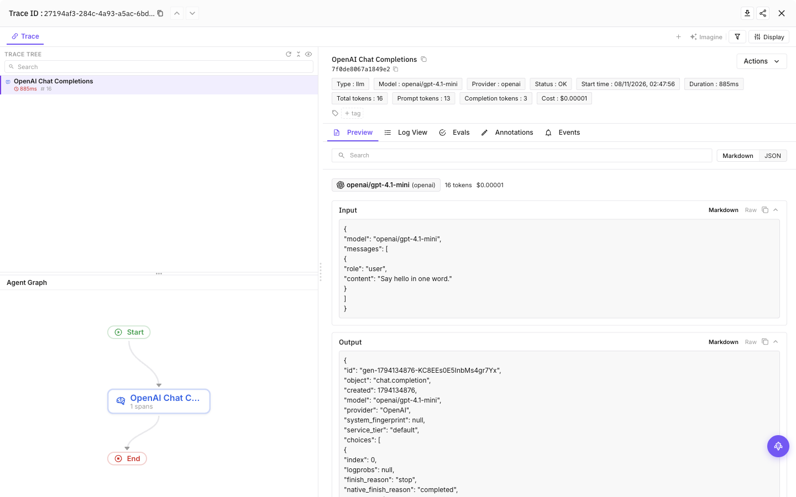

# @traceai/auto

**Trace your Node.js AI calls without changing your application code.** Preload once to capture supported model requests, responses, token usage and timing as OpenTelemetry spans.

[Quick start](#quick-start) · [Coverage](#supported-libraries-and-protocols) · [Privacy](#privacy-defaults) · [Frameworks](#frameworks-and-deployment) · [Troubleshooting](#troubleshooting)

## Quick start

You need **Node.js 20.6+**, an existing Node application, and a [Future AGI](https://app.futureagi.com) API key / secret key pair. Keep your model provider's credentials configured as usual; traceAI does not supply a model key.

Install in your application's directory:

```sh
npm install @traceai/auto
```

Set both FI keys through your deployment's secret manager or shell environment, then start the app with one preload:

```sh
FI_API_KEY="your-api-key" FI_SECRET_KEY="your-secret-key" \
FI_PROJECT_NAME="my-ai-app" \
node --import @traceai/auto/register app.mjs
```

Replace `app.mjs` with your entry file. **Prompts and responses are captured by default.** To hide them, set `FI_HIDE_INPUTS=true FI_HIDE_OUTPUTS=true FI_HIDE_ERROR_DETAILS=true` before startup. See [privacy defaults](#privacy-defaults) before deploying with sensitive data.

Make an AI request, consume the response, then open **Observe → my-ai-app** in Future AGI. For supported calls, the trace includes the provider/model, input and output, duration, and any usage the provider returned. Streaming timing is available when the transport exposes it; missing usage is not invented.

### Keep your existing start command

With the FI variables above already set, use `NODE_OPTIONS` for an npm script or process launcher:

```sh
NODE_OPTIONS="--require @traceai/auto/register" npm start
```

Use `--require` in `NODE_OPTIONS`: every Node version accepts it, while a Node without `--import` refuses to start when `NODE_OPTIONS` contains it. On an unsupported Node version the agent prints one warning and the application runs untraced. Preserve any other Node flags your deployment already needs. For CommonJS, either use the same `--import` preload or:

```sh
node --require @traceai/auto/register app.cjs
```

Run from the application's directory so target libraries and optional instrumentors can be resolved. Do not add a second preload or manually patch the same client.

### Try it with OpenAI

If you do not have an app yet, install the OpenAI SDK (versions 4 to 7 are supported):

```sh
npm install openai
```

Set `OPENAI_API_KEY` and `OPENAI_MODEL` for a model your account can use. Save this ordinary application code as `app.mjs`, then use the quick-start run command. There are **no tracing imports** in the application:

```js
import OpenAI from "openai";

const response = await new OpenAI().chat.completions.create({
  model: process.env.OPENAI_MODEL,
  messages: [{ role: "user", content: "Say hello in one word." }],
});
console.log(response.choices[0].message.content);
```

The preload flushes completed spans when Node exits naturally. If your app explicitly terminates or runs inside a serverless invocation, use the [lifecycle guidance](https://github.com/future-agi/traceAI/blob/dev/typescript/packages/traceai_auto/docs/FRAMEWORKS.md#aws-lambda-and-short-lived-processes).

## What you get

The **Try it with OpenAI** example, as it appears in Future AGI (a real run with OpenAI SDK 7 and `openai/gpt-4.1-mini` through OpenRouter):



- **Model calls without per-call wrappers.** OpenAI instrumentation is included. Recognized AI requests through the process's global `fetch` are also captured, including compatible gateways.
- **More context from installed integrations.** Dedicated packages can add framework, agent, tool, retrieval and database spans. They retain their own method/version limits; auto-registration does not expand their coverage.
- **One trace, not two copies of each call.** Wire capture yields to covered model spans and respects OpenTelemetry suppression. On the default route it yields only to model spans the agent made, since your own model spans stay with your provider. It still yields when your code wraps the provider request in one recorded span of its own inside such a model span, or in a span from an app that has a context manager but no tracer provider. See the limits below for the cases it misses.
- **Your OpenTelemetry setup stays yours.** The agent registers no global tracer provider, context manager or propagator, and by default never adds a processor to your provider (the outgoing propagation opt-in below adds one that only observes span starts). An SDK you start before or after the preload registers normally and its exporters keep receiving your spans. AI spans still parent under your active span.
- **Standard OpenTelemetry.** Send to Future AGI by default, or use an [application-owned provider/exporter](https://github.com/future-agi/traceAI/blob/dev/typescript/packages/traceai_auto/docs/CONFIGURATION.md#bring-your-own-opentelemetry-destination) without FI credentials.

This is AI instrumentation, not a general-purpose APM agent. **Future AGI receives only AI spans**: wire spans and spans from traceAI integrations. Your HTTP, database, cache and custom spans stay with your own provider. Incoming HTTP spans are off unless `FI_INSTRUMENTATIONS` lists `http`; even then a request span is sent only when the request made an AI call. When your application already has its own tracer provider at startup, the agent leaves incoming HTTP to your setup, prints one warning and reports `http` as disabled. Database integrations that the agent enables (pgvector, Redis, MongoDB) trace only vector operations. Outgoing non-AI HTTP calls, arbitrary application functions and every possible AI transport are not automatically traced. To also send your application's own spans, as earlier releases did, set `FI_FORWARD_APP_SPANS=true` (or `forwardApplicationSpans: true` in `init()`); see [forwarding application spans](https://github.com/future-agi/traceAI/blob/dev/typescript/packages/traceai_auto/docs/CONFIGURATION.md#forwarding-application-spans). Genkit creates its spans with the global tracer provider, so on the default route they stay with your provider and `report()` shows `genkit` as `manual`; the forwarding switch sends them.

## Supported libraries and protocols

**Included:** OpenAI library hooks and the global-fetch wire observer. **Optional:** other dedicated instrumentors must be installed alongside their target library. The app always owns installation of its AI SDKs.

To see what your app needs, without installing anything:

```sh
npx --no-install traceai-auto bootstrap
```

Bootstrap lists detected libraries, their status, and suggested install commands. It can also install missing instrumentors with an explicit `--install` flag; see the [CLI reference](https://github.com/future-agi/traceAI/blob/dev/typescript/packages/traceai_auto/docs/CONFIGURATION.md#cli).

### Library coverage

The table below is generated from [`src/integrations.json`](https://github.com/future-agi/traceAI/blob/dev/typescript/packages/traceai_auto/src/integrations.json), the runtime registry. **Import hook** means the package registers hooks for supported target versions. **Enable entry** means automatic setup depends on the installed integration exposing its enable API. **Manual** means framework-level tracing still requires that package's explicit API; eligible underlying global-fetch calls can still be captured.

<details>
<summary>All registered libraries and framework adapters</summary>

<!-- BEGIN GENERATED INTEGRATIONS -->
| Configuration name | Target library | Instrumentation package | Setup |
| --- | --- | --- | --- |
| `anthropic` | `@anthropic-ai/sdk`, `@anthropic-ai/bedrock-sdk`, `@anthropic-ai/vertex-sdk` | `@traceai/anthropic` | Import hook |
| `bedrock` | `@aws-sdk/client-bedrock-runtime`, `@aws-sdk/client-bedrock-agent-runtime` | `@traceai/bedrock` | Import hook |
| `beeai` | `beeai-framework` | `@traceai/beeai` | Import hook |
| `cerebras` | `@cerebras/cerebras_cloud_sdk` | `@traceai/cerebras` | Import hook |
| `chromadb` | `chromadb` | `@traceai/chromadb` | Import hook |
| `claude-agent-sdk` | `@anthropic-ai/claude-agent-sdk` | `@traceai/claude-agent-sdk` | Manual |
| `codex-sdk` | `@openai/codex-sdk` | `@traceai/codex-sdk` | Manual |
| `cohere` | `cohere-ai` | `@traceai/cohere` | Import hook |
| `cursor-sdk` | `@cursor/sdk` | `@traceai/cursor-sdk` | Import hook |
| `deepseek` | `openai` | `@traceai/deepseek` | Import hook |
| `elevenlabs` | `@elevenlabs/elevenlabs-js` | `@traceai/elevenlabs` | Manual |
| `fireworks` | `openai` | `@traceai/fireworks` | Import hook |
| `genkit` | `genkit` | `@traceai/genkit` | Enable entry |
| `google-adk` | `@google/adk` | `@traceai/fi-instrumentation-google-adk` | Import hook |
| `google-genai` | `@google/generative-ai` | `@traceai/google-genai` | Import hook |
| `google-genai-sdk` | `@google/genai` | `@traceai/google-genai-sdk` | Manual |
| `groq` | `groq-sdk` | `@traceai/groq` | Import hook |
| `guardrails` | `@guardrails-ai/core` | `@traceai/guardrails` | Import hook |
| `huggingface` | `@huggingface/inference` | `@traceai/huggingface` | Import hook |
| `huggingface-transformers` | `@huggingface/transformers` | `@traceai/huggingface-transformers` | Manual |
| `instructor` | `@instructor-ai/instructor` | `@traceai/instructor` | Import hook |
| `lancedb` | `@lancedb/lancedb` | `@traceai/lancedb` | Import hook |
| `langchain` | `@langchain/core` | `@traceai/langchain` | Import hook |
| `livekit` | `livekit-client`, `@livekit/rtc-node` | `@traceai/fi-instrumentation-livekit` | Import hook |
| `llamaindex` | `llamaindex`, `@llamaindex/openai` | `@traceai/llamaindex` | Import hook |
| `mastra` | `@mastra/core`, `@mastra/observability`, `@mastra/otel-exporter` | `@traceai/mastra` | Manual |
| `mcp` | `@modelcontextprotocol/sdk` | `@traceai/mcp` | Import hook |
| `milvus` | `@zilliz/milvus2-sdk-node` | `@traceai/milvus` | Import hook |
| `mistral` | `@mistralai/mistralai` | `@traceai/mistral` | Import hook |
| `mongodb` | `mongodb` | `@traceai/mongodb` | Import hook |
| `n8n` | `n8n-core` | `@traceai/n8n` | Import hook |
| `ollama` | `ollama` | `@traceai/ollama` | Import hook |
| `openai` | `openai` | `@traceai/openai` (included) | Import hook |
| `openai-agents` | `@openai/agents` | `@traceai/openai-agents` | Import hook |
| `openrouter` | `@openrouter/sdk` | `@traceai/openrouter` | Manual |
| `pgvector` | `pg`, `pgvector` | `@traceai/pgvector` | Import hook |
| `pi-coding-agent` | `@mariozechner/pi-coding-agent` | `@traceai/pi-coding-agent` | Manual |
| `pinecone` | `@pinecone-database/pinecone` | `@traceai/pinecone` | Import hook |
| `pipecat` | `@pipecat-ai/client-js` | `@traceai/fi-instrumentation-pipecat` | Import hook |
| `portkey` | `portkey-ai` | `@traceai/portkey` | Import hook |
| `qdrant` | `@qdrant/js-client-rest` | `@traceai/qdrant` | Import hook |
| `redis` | `redis` | `@traceai/redis` | Import hook |
| `sagemaker` | `@aws-sdk/client-sagemaker-runtime` | `@traceai/sagemaker` | Import hook |
| `strands` | `@strands-agents/sdk` | `@traceai/strands` | Import hook |
| `together` | `together-ai` | `@traceai/together` | Import hook |
| `typesafe` | `@typesafe-ai/sdk` | `@traceai/typesafe` | Import hook |
| `vercel` | `ai` | `@traceai/vercel` | Enable entry |
| `vertexai` | `@google-cloud/vertexai` | `@traceai/fi-instrumentation-vertexai` | Import hook |
| `vitest-evals` | `vitest-evals` | `@traceai/vitest-evals` | Manual |
| `vllm` | `openai` | `@traceai/vllm` | Import hook |
| `voltagent` | `@voltagent/core` | `@traceai/voltagent` | Manual |
| `weaviate` | `weaviate-client` | `@traceai/weaviate` | Import hook |
| `xai` | `openai` | `@traceai/xai` | Import hook |
<!-- END GENERATED INTEGRATIONS -->

</details>

Dedicated instrumentors other than OpenAI are not installed implicitly. The bundled server-build adapters are inactive until you add their plugin to your build configuration. Genkit and Vercel versions without an enable entry report `manual`. Mastra is manual-only in this release. LangChain is not traced by the agent yet, in ES-module and CommonJS apps alike: the integration stays `pending`, and the model requests LangChain sends are still recorded: by the provider SDK's integration when one is on, otherwise as wire spans. See each integration's README for supported methods and versions, and use doctor to inspect the version actually installed in your app.

Without an application context manager, calls from BeeAI, the OpenAI
Agents SDK, the Vercel AI SDK 7, Genkit and ElevenLabs can also produce a
wire span for the call's own request. BeeAI and the OpenAI Agents SDK
start spans in the SDK's own event handlers or trace processor, so the
agent cannot tie the SDK's request to the span without guessing. The
Vercel AI SDK 7 and Genkit are turned on through their own enable entry,
outside the agent's call scope. ElevenLabs patches namespace getters
without the agent's scope and starts its span outside a call cell.
Neither the call nor a request beside it is dropped.
See [Limits to plan for](#limits-to-plan-for).

### HTTP protocol coverage

The [wire catalog](https://github.com/future-agi/traceAI/blob/dev/typescript/packages/traceai_auto/src/wire/wire-protocols.json) recognizes OpenAI-compatible chat, Responses, embeddings and media endpoints; Anthropic messages; Gemini/Vertex content and embeddings; Cohere chat/embed/rerank; Bedrock converse/invoke; Ollama; and selected Deepgram, ElevenLabs, AssemblyAI and Cartesia endpoints.

Recognition needs a matching endpoint and request shape, not just an AI-looking URL. Unknown proxy hosts can use compatible protocol fallbacks; provider-restricted endpoints still require a recognized host. Audio bytes are counted, not exported. Bedrock binary event streams are metadata-only. See [capture behavior and transport limits](https://github.com/future-agi/traceAI/blob/dev/typescript/packages/traceai_auto/docs/ARCHITECTURE.md).

## Privacy defaults

| Surface | Default behavior | Your control |
| --- | --- | --- |
| Prompts, model outputs, tool content and transcripts | Captured where supported | `FI_HIDE_INPUTS=true`, `FI_HIDE_OUTPUTS=true`; granular message/text flags are available |
| Error details | Visible unless an input/output value, message, text or invocation-parameter hide flag implies hiding | `FI_HIDE_ERROR_DETAILS=true`; explicit `false` overrides the derived value, not secret/media masking |
| Known credentials and signed URL values | Scrubbed in traceAI's export view | Additional exact secrets can be registered with `registerSecret()`; never rely on this to detect arbitrary free-text secrets |
| PII pattern redaction | **Off** | `FI_PII_REDACTION=true`; pattern matching is not comprehensive PII detection |
| Base64 media and raw audio | Recognized payloads omitted; no audio bytes exported | Image cap defaults to `0`; increasing it does not enable base64 image export |
| Embeddings | Catalog wire formats record dimensions, not vectors | `FI_HIDE_EMBEDDING_VECTORS=true` also hides vectors on library/forwarded and generic-JSON routes |
| Your application's own spans | **Not sent** to Future AGI | `FI_FORWARD_APP_SPANS=true` sends them; `FI_HIDE_*` then also hides other AI tracers' prompt and response keys on them |
| Extra instrumentors / server bundler plugins | Extra instrumentors are not installed; build plugins are inactive until configured | Install the integration or explicitly add a server bundler plugin |

The agent sanitizes a detached copy for its own exporter. **Other exporters retain their own privacy policies.** Explicit application-owned processors are not silently rewritten. Host SDK limits may force the FI view to withhold content as `<unknown: host-truncated>` rather than export a partial value. Unknown, transformed or unobserved secrets cannot always be recognized; use the hide flags for sensitive content.

[All privacy flags and defaults](https://github.com/future-agi/traceAI/blob/dev/typescript/packages/traceai_auto/docs/CONFIGURATION.md#privacy-options) · [Detailed privacy boundaries](https://github.com/future-agi/traceAI/blob/dev/typescript/packages/traceai_auto/docs/ARCHITECTURE.md#privacy)

## Configuration

The most-used settings are below. Set them **before** loading the agent; later `init()` calls do not reconfigure it.

| Environment variable | Default | Purpose |
| --- | --- | --- |
| `FI_API_KEY` + `FI_SECRET_KEY` | Unset | Complete pair for the default Future AGI destination |
| `FI_PROJECT_NAME` | See full reference | Project in Observe; set explicitly for stable routing |
| `FI_BASE_URL` | `https://api.futureagi.com` | Collector base URL or full traces endpoint, including a self-hosted one. The FI keys are sent only to this endpoint; an application-owned destination uses only the headers configured for it |
| `FI_INSTRUMENTATIONS` | All eligible integrations, except `http` | Comma-separated allowlist, e.g. `openai,wire`; incoming HTTP spans need `http` listed here |
| `FI_DISABLED_INSTRUMENTATIONS` | Empty | Denylist; takes precedence over the allowlist |
| `FI_WIRE_CAPTURE` | `true` | Enable global-fetch capture and transport credential observation |
| `FI_SAMPLE_RATE` | Unset | Explicit sampling ratio for AI spans on the agent's own provider; overrides OTel sampler settings. Retains trace-id sampling and records admitted AI spans under an unsampled parent with the sampled flag off; see [Limits to plan for](#limits-to-plan-for) |
| `FI_FORWARD_APP_SPANS` | `false` | Also send the application's own spans to Future AGI |
| `FI_AUTO_DEBUG` | `false` | Print the masked startup report |
| `OTEL_SDK_DISABLED` | `false` | Disable auto-instrumentation |

`FI_BASE_URL`, `baseUrl`, and `base_url` in `futureagi.toml` (read from the working directory, or `FI_CONFIG_FILE`) or an fi profile all select the destination of the FI keys. When the file or a profile chose it, `init()` logs `Sending traces to <host> (base URL from the config file)` once, naming only the host; set `FI_BASE_URL` or `baseUrl` in code to take that decision out of the file. A self-hosted deployment is configured the same way: set `FI_BASE_URL` to its base URL together with the FI keys. A self-hosted `http://` base URL has its FI keys refused, so no traces are exported, unless `FI_ALLOW_INSECURE_HTTP=1` or `allowInsecureHttp: true` is set; literal loopback (`localhost`, `127.0.0.1`, `::1`) needs no setting, and a Future AGI host (`futureagi.com`) always needs `https://`.

**Transport and proxy.** Key-carrying sends use `@traceai/fi-core`'s own pinned transport (`undici` 6.29.1): an application's global dispatcher (including one a library such as `@openai/agents` installs), `globalThis.fetch` wrappers, APM instrumentation, mocks and polyfills are not used for them and do not see them, and `@traceai/auto` may load before or after any of them. The application's own requests are unaffected. TLS verification is always on. A `dispatcher` option on a key-carrying send is refused with `FI_DISPATCHER_UNKNOWN`. Code that runs before the agent loads can still tamper with modules; that is out of scope. Subscribers to undici `diagnostics_channel` events see the request headers of these sends, the keys included. Exporting behind an https proxy: set `FI_HTTPS_PROXY` (or `httpsProxy` in `init`, which wins over it) to an `http://` or `https://` proxy URL, or start Node with `NODE_USE_ENV_PROXY=1` and set `HTTPS_PROXY` (`https_proxy`, as Node reads it) and `NO_PROXY`, which are read once when the package loads. The SDK opens its own CONNECT tunnel, for https destinations only; the destination's certificate is always verified, and so is the proxy's own for an `https://` proxy. `FI_HTTPS_PROXY` and `httpsProxy` apply whatever `NO_PROXY` says. A proxy URL with any other scheme is refused with `FI_PROXY_UNSUPPORTED`. Credentials in the proxy URL go to the proxy as `Proxy-Authorization` and travel unencrypted to an `http://` proxy. The proxy URL and its credentials are not logged, reported or exported. A send that carries no key goes direct and is not subject to the proxy rules. A plaintext destination is refused with `FI_PLAINTEXT_PROXIED` while a proxy is configured, loopback included. gRPC does not use `FI_HTTPS_PROXY` or `httpsProxy`.

An explicit `sampleRate`, `FI_SAMPLE_RATE` or file `sample_rate` wins. Otherwise, agent-created providers honor `OTEL_TRACES_SAMPLER` / `OTEL_TRACES_SAMPLER_ARG`, defaulting to `ParentBased(TraceIdRatio(1))`; invalid settings fall back to that default with one agent warning. Parent-based samplers follow the parent's sampled flag, and dropped spans stay dropped. An application-owned provider always keeps its own sampler.

On agent-created providers, sampled spans carry the numeric attribute `fi.sampling.ratio` (`0 < r < 1`) when the agent makes a fractional local ratio decision or inherits a valid ratio from a sampled parent's `fi=r:<ratio>` tracestate entry. All parent-based selections (including the default, `parentbased_always_on` / `parentbased_always_off` and `parentbased_traceidratio` at any root rate) and explicit `FI_SAMPLE_RATE` / `sampleRate` copy that entry for remote and local parents, even when the local root rate is `1`. Roots sampled locally at `1`, record-only spans, unsampled parents, invalid parent ratios and application-owned providers are not stamped. Non-parent-based `always_on` / `always_off` / `traceidratio` never inherit; fractional `traceidratio` stamps its own local ratio instead. An absent attribute is treated as `1.0` for dashboard weighting; on the agent's own provider, ratio metadata reserves one positive-budget attribute slot (displacing the last admitted ordinary attribute if necessary), but a zero budget, privacy redaction and fail-closed export refusal still take precedence. Local fractional ratio decisions also write `fi=r:<ratio>` in W3C tracestate, preserving other vendors' entries except rightmost entries that must be evicted to fit W3C limits, so children can inherit the trace-wide ratio across process boundaries. Explicit rates keep their existing local trace-id decisions, including dropping rejected trace IDs under sampled parents and recording admitted spans under unsampled parents with the sampled flag off.

[Full configuration reference](https://github.com/future-agi/traceAI/blob/dev/typescript/packages/traceai_auto/docs/CONFIGURATION.md) covers every `init()` option, environment setting, config/profile precedence, privacy flag and CLI command.

### Session, user and metadata for AI spans

The agent registers no context manager. If your application has its own OpenTelemetry
SDK, fi-core's context helpers used with `context.with` (for example
`context.with(setSession(context.active(), { sessionId }), fn)`) reach AI spans as usual.
Without one, `context.with` does nothing, so use the agent's helpers. They work in both
cases and register nothing globally:

```js
const { withSession, withUser, withMetadata, withContext, withTracingSuppressed } = require('@traceai/auto');

await withSession('session-42', () => withUser('user-7', () => withMetadata({ plan: 'pro' }, () => answer(question))));
await withTracingSuppressed(() => healthCheckCall()); // no AI span, and other OpenTelemetry instrumentations see the suppression
await withContext(myContext, () => answer(question)); // runs with exactly this context
```

`withSession`, `withUser`, `withMetadata` and `withTracingSuppressed` add to the current
context and nest. `withContext(ctx, fn)` runs `fn` with `ctx` both in the agent's own
context and through `context.with`.

### Outgoing W3C propagation (HTTP/HTTPS only)

Experimental propagation for **`node:http` and `node:https` only** is **off by default**.
It adds eligible W3C `traceparent`, `tracestate` and existing Context baggage without
creating HTTP CLIENT spans. It is independent of wire/body capture and optional
incoming HTTP instrumentation.

**Outbound propagation for fetch/Undici is not supported yet:** global `fetch`,
`undici.fetch` and `undici.request` receive no propagation adapter from F4. Existing
AI global-fetch wire capture and transport credential observation are separate
features and remain unchanged. No fetch/Undici redirect-propagation support is claimed.

Enable native propagation explicitly, before preload:

```sh
export TRACEAI_PROPAGATE_OUTGOING_ADAPTERS=true
export TRACEAI_PROPAGATE_OUTGOING=default
export TRACEAI_PROPAGATE_HOSTS='+orders.internal,+*.svc.example,-payments.svc.example'
node --import @traceai/auto/register app.mjs
```

| Code option | Environment variable | Config-file key | Default |
| --- | --- | --- | --- |
| `propagateOutgoingAdapters` | `TRACEAI_PROPAGATE_OUTGOING_ADAPTERS` | `propagate_outgoing_adapters` | `false` |
| `propagateOutgoing` | `TRACEAI_PROPAGATE_OUTGOING` | `propagate_outgoing` | `default` |
| `propagateHosts` | `TRACEAI_PROPAGATE_HOSTS` | `propagate_hosts` | No explicit rules |

Headers are added only under spans whose start the agent observed. With the opt-in on
and an FI route, the agent therefore adds one processor to your tracer provider (found
on the API at startup, on the next tick, or at the next AI span start) that only notes when your spans
start; it never exports, ends or changes a span, and is removed at shutdown. Requests
read the active span through your context manager, so an application without its own
OpenTelemetry setup gets no headers from this adapter.

Policy alone, even `all`, never activates the adapter. Shared-catalog vendor hosts
and provider ports (including Ollama's `11434`) are **unconditionally excluded**,
regardless of request path, mode or matching positive rule. `none` disables all agent
additions; explicit denies win. Positive rules only narrow the eligible destinations.
`all` is retained as a compatibility spelling with the same mandatory exclusions as
`default`; neither mode bypasses privacy or redirect checks. Host rules and catalog
checks share lowercase/WHATWG IDNA normalization with exactly one terminal DNS dot
removed; case, Unicode full-stop and trailing-dot variants do not bypass exclusions.
Unknown compatible proxies cannot be recognized as vendors; prefer a positive allowlist.
See [policy grammar, precedence and limits](docs/CONFIGURATION.md#outgoing-httphttps-propagation).

Headers are prepared with local W3C serializers and the existing FI privacy filter,
not the application's custom global propagator. No root trace IDs or new baggage
are invented. Existing traceparent (even empty/invalid), suppression and an observed
CLIENT span veto additions. Existing application headers are never rewritten; opaque
local contexts and ambiguous/custom transport authorities conservatively skip.
Baggage keys/values are percent-encoded and validated as W3C tokens/octet sequences;
metadata must already be ASCII-safe W3C properties. Invalid members are omitted,
not repaired into headers. Every final field is checked before normal or early writes.

Native admission binds Host and the request target to stock agent connection options,
including the effective port, not a port inferred from Host. Early raw/Expect headers
wait for that authority proof; only a pristine, unsent Expect header queue can be
amended, preserving body bytes, callbacks and accounting.

**Attributable cross-origin redirect chains never receive fresh agent headers.**
Before native response listeners run, Location is resolved by WHATWG URL relative
to the proven serialized request URL. Same-origin requires both normalized authority
agreement and strict WHATWG origin identity (scheme, platform hostname and effective
port). DNS equivalence alone is insufficient: dotted and undotted hostnames are
separate HTTP origins, even though policy checks exclude both spellings alike.
Ambiguous references such as `http:host/path` or `http:/host/path`, malformed Location
and unproven request targets fail closed. A cross-origin or unprovable redirect
closes the captured request Context/span/baggage identities,
observed descendant spans (even precreated ones), and async work inheriting the
response listener Context. This covers callback and retained-context `await`
follow-ups and remains closed if a chain returns to its first origin. Reusing the
same identities for unrelated traffic is conservatively closed too; fresh unrelated
contexts remain eligible. Application-owned propagation headers are not removed.

Attribution requires observing the native response and a retained Context, span,
baggage identity or observed span ancestry. Explicitly detached/reconstructed root
contexts, other workers/processes and responses bypassing the native hook cannot be
correlated; no URL/trace-ID guessing is performed. HTTP/HTTPS and F4 never follow
redirects themselves or create follow-up requests. Agent fields are never copied
into caller-owned reusable options. See the [precise boundary](docs/CONFIGURATION.md#native-redirect-boundary).

`report()` exposes only `outgoing-http`: disabled without opt-in, pending with a valid
enabled policy, and instrumented only after a header batch is committed. Shutdown
removes owned hooks and makes retained wrappers inert. No header values are added to
telemetry. Private Node header/agent shapes are guarded, not a promise of arbitrary
runtime, proxy, HTTP/2, worker, browser or custom-agent coverage; qualify native
HTTP/HTTPS receipt, TLS, body/error parity and lifecycle on your deployed Node version.

## Frameworks and deployment

| Environment | Start here |
| --- | --- |
| Node ESM or CommonJS | Use `--import` before app imports; CommonJS also supports `--require` |
| Next.js Node runtime | Use guarded `instrumentation.ts` and keep the package external; do not import it into an edge path |
| esbuild, Vite SSR, Rollup or webpack | Opt into the Node-server adapter and deploy the complete agent payload; keep AI SDKs external for library hooks |
| AWS Lambda | Initialize once outside the handler and flush at each invocation boundary, not just process exit |
| Edge / browser | The Node preload is not supported. The `/edge` subpath is a low-level fetch observer, not a configured tracing SDK |
| Existing OpenTelemetry setup | Start your SDK as usual, before or after the preload; the agent keeps its own provider and sends only AI spans |

[Framework recipes and packaging requirements](https://github.com/future-agi/traceAI/blob/dev/typescript/packages/traceai_auto/docs/FRAMEWORKS.md)

## Troubleshooting

Run diagnostics from the app directory with the same FI environment as the app:

```sh
npx --no-install traceai-auto doctor
```

Doctor sends one test span when instrumentation is enabled. Check the JSON `collector` field: `accepted`, `failed` or `not_tested (...)`. **The CLI exit code alone is not a collector-health check.** Doctor is a separate process, so its `pending` library hooks do not tell you whether your running app has imported that library.

For a configuration/status report without the test export:

```sh
npx --no-install traceai-auto doctor --no-check
```

| Symptom | What to check |
| --- | --- |
| Everything is `disabled` | Supply both FI keys in the same source, or pass a destination to `init()`. An application provider alone is not a destination. Check `OTEL_SDK_DISABLED` and the allowlist/denylist. |
| `collector: failed` | Check `FI_BASE_URL`, both keys, outbound connectivity and collector access. Initialization itself never probes the collector. |
| `collector: not_tested` | No completed test export yet, `--no-check`, zero sampling, or an application-owned destination. It is not a success signal. |
| `missing_instrumentor` | Install the suggested dedicated package from bootstrap, then restart. |
| Library stays `pending` | Load the agent before the SDK; check supported versions and keep the SDK external when bundling. A registered hook is not proof a call was traced. |
| Library reports `manual` | Use its explicit wrapper/processor API; automatic framework-level tracing is unavailable for that installed version. |
| No wire span | Consume or cancel the response; check the catalog and transport. Direct `undici.fetch`, `node-fetch`, WebSocket and gRPC are not global-fetch wire capture. |
| Output is missing or unknown | Check hide flags, body cap and host OTel attribute limits. Dropped/truncated host data cannot be reconstructed. |
| Duplicate spans | Remove duplicate manual instrumentation/preloads; avoid layering an invocation wrapper over another Lambda tracing layer. |

## Limits to plan for

- **Per process/isolate:** preload every Node worker or child process you want to observe; globals are not shared between isolates.
- **Bounded capture:** the default text body cap is 4 MiB. Request streams and opaque `Request` bodies are not consumed for inspection. Native `pipeTo`/`pipeThrough` can provide metadata-only completion.
- **Response-driven completion:** unread and never-ending responses do not produce completed wire spans. Flush does not consume them for you. Cancelling a clone can end the shared capture before another branch finishes.
- **Provider error semantics:** an error inside an HTTP 200 stream can retain HTTP-derived OK status; inspect finish reasons as well.
- **Best-effort delivery:** natural-exit/SIGTERM flushes are bounded. Hard termination, Lambda freezing and collector failures can lose spans. The agent never makes app success depend on export success.
- **Spans your app creates inside an AI call:** Spans your application creates inside an AI call (for example its own HTTP span for the provider request, or a database span inside a tool) are parented to a span that only Future AGI receives, so your own tracing backend shows them without that parent. They keep the same trace id. With an explicit FI sample rate, admitted AI spans under an unsampled parent keep the sampled flag off; with a parent-based agent sampler, that AI span is dropped instead. Non-parent-based OTel samplers make their own decision. Nothing of your application's is sent to Future AGI, and your provider and exporters are untouched.
- **An AI request inside two or more of your own recorded spans:** when your code wraps the provider request in two or more recorded spans of its own in a row (for example a custom `fetch` that starts a request span and then an attempt span), Future AGI receives that call twice. It arrives as the integration's AI span and as a wire span whose parent is your inner span, which Future AGI does not receive. None of your spans is sent. One recorded span of yours around the request does not cause this, and neither does a span from an app that has a context manager but no tracer provider.
- **An AI request inside a span your sampler did not record, when an explicit FI sample rate admits the AI spans:** in a trace your sampler did not sample (with an always-off, trace-id-ratio or parent-based sampler), a span your code starts around the provider request (for example in a custom `fetch`) gets an id of its own and no parent id, so the agent cannot connect it to the AI span. Future AGI then receives that call twice: as the integration's AI span and as a wire span whose parent is your span, which Future AGI does not receive. None of your spans is sent. The agent does not guess from the trace id: a separate AI request that your code sends with plain `fetch` in the same trace looks just the same, and a guess would drop it. In this case the call arrives twice rather than being dropped.
- **A different model request made inside an AI call:** while an integration's AI call runs, wire capture takes every model API request made inside that call to be the call's own, which the AI span already records. If code that runs inside the call sends a different request to a model API (for example a custom `fetch` you give the SDK that first asks another model), that request gets no span of its own.
- **Calls outside the agent's scope can arrive twice without an
  application context manager:** BeeAI and the OpenAI Agents SDK start
  spans in the SDK's own event handlers or trace processor, so the agent
  cannot tie the SDK's request to the span without guessing. The Vercel
  AI SDK 7 and Genkit are turned on through their own enable entry,
  outside the agent's call scope. ElevenLabs patches namespace getters
  without the agent's scope and starts its span outside a call cell.
  For these five integrations, the call's own request can also arrive
  in Future AGI as a wire span beside its AI span. Nothing is lost: a
  request your code sends beside the call, in the same tick or while it
  reads a stream, arrives as a wire span of its own. With an application
  context manager, these calls arrive once. With the Vercel AI SDK 5 and
  6, the AI SDK's spans nest without a context manager.
- **Groq, Mistral and Portkey need updated integrations:** the fix needs
  `@traceai/groq` 0.1.2 or later, `@traceai/mistral` 0.1.2 or later and
  `@traceai/portkey` 0.1.3 or later. They keep their AI span to the SDK
  call through a per-instance hook, even without an application context
  manager: the SDK's own request no longer also arrives as a wire span,
  and a request beside it still arrives as its own wire span. With older
  versions of these packages, the call's own request can still arrive
  twice. OpenAI and other integrations using OpenTelemetry's
  instrumentation wrapper also keep their AI span to the call.
  **Portkey Responses API limitation:** it delegates to the `openai`
  package. When the agent's OpenAI integration is also on and the app
  has no context manager, OpenAI starts its own span too. The request
  produces two nested AI spans and no wire span; the call is not lost.
- **LangChain is not traced by the agent yet:** in ES-module and CommonJS apps alike, the LangChain integration stays `pending` and records no LangChain spans. The model requests LangChain sends are still recorded: by the provider SDK's integration when one is on, otherwise as wire spans, so the calls themselves are not lost. Use `@traceai/langchain`'s own API until a later release adds it.

[Architecture, complete capture limits and redistribution notices](https://github.com/future-agi/traceAI/blob/dev/typescript/packages/traceai_auto/docs/ARCHITECTURE.md)

## Legal notices

Keep `dist/THIRD-PARTY-NOTICES`, `dist/third-party-manifest.json` and the linked `.LEGAL.txt` files with any redistributed launcher or edge payload. [Redistribution details](https://github.com/future-agi/traceAI/blob/dev/typescript/packages/traceai_auto/docs/ARCHITECTURE.md#legal-notices).

## More resources

[Future AGI tracing guide](https://docs.futureagi.com/docs/tracing) · [Integration guides](https://docs.futureagi.com/docs/integrations/traceai) · [Manual TypeScript SDK](https://github.com/future-agi/traceAI/blob/dev/typescript/packages/fi-core/README.md) · [Report an issue](https://github.com/future-agi/traceAI/issues)
